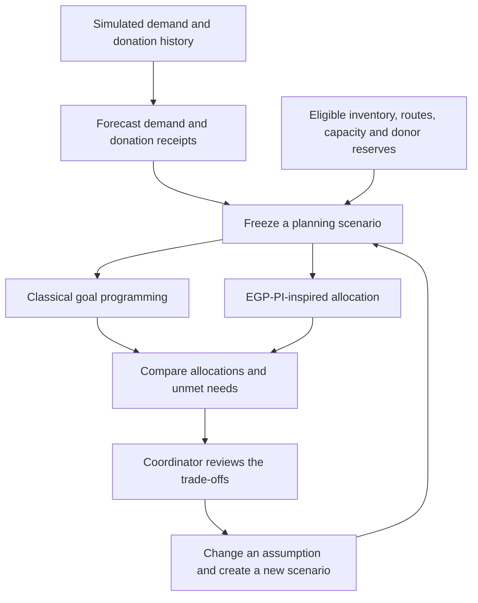

# PantryPulse

**See the shortage. Understand the trade-off. Plan a fairer response.**

PantryPulse is a food-bank planning application being built to help coordinators anticipate shortages and compare how limited food supplies could be shared across communities with different needs.


[](LICENSE)


Built for **Gator Hack V · October 23–25, 2026**.

> **Prototype status:** The offline forecasting core, backend allocation helpers, API health endpoint and frontend foundation are implemented. The paired allocation engines and connected planning dashboard are still in development. Demo data and vulnerability indicators are simulated.

## Table of contents

- [The problem](#the-problem)
- [Our solution](#our-solution)
- [What makes PantryPulse different](#what-makes-pantrypulse-different)
- [Demo and workflow](#demo-and-workflow)
- [Features and current progress](#features-and-current-progress)
- [Research foundation](#research-foundation)
- [Technology](#technology)
- [Installation and setup](#installation-and-setup)
- [Usage and examples](#usage-and-examples)
- [Configuration](#configuration)
- [Roadmap](#roadmap)
- [Contributing](#contributing)
- [License](#license)
- [Credits and contact](#credits-and-contact)

## The problem

**When there is not enough food for everyone, where should the next donation go?**

A food-bank coordinator has to balance more than inventory totals. One pantry may face a larger shortage, another may serve a more vulnerable community, and a third may hold food that will expire before it can be used. Storage capacity, delivery routes and the donor's own needs further limit the choices.

Dividing supplies equally can overlook differences in need. Focusing only on delivery convenience can leave the hardest-to-serve communities further behind. A stock count alone cannot explain these trade-offs.

PantryPulse starts with that decision: how can a coordinator see an upcoming shortage, explore feasible responses and understand whose needs remain unmet?

## Our solution

We are building a planning workspace that connects **demand forecasts, usable inventory and research-inspired allocation**. The intended experience lets a coordinator:

1. **Anticipate need:** estimate upcoming demand and donation receipts while keeping forecasts separate from confirmed stock.
2. **Compare responses:** calculate a conventional allocation and a vulnerability-aware allocation using the same supplies, requests and operating limits.
3. **Understand the consequences:** inspect who receives food, what remains unmet and how priorities change the recommendation.
4. **Explore a change:** adjust a donation, demand assumption or policy and compare a new scenario with the original.

The goal is to make allocation choices understandable before a coordinator acts. The hackathon demonstration is a simulated planning exercise; it does not purchase supplies or dispatch deliveries.

## What makes PantryPulse different

- **Fairness affects the proposed decision.** The planned research-inspired method includes institutional vulnerability and deprivation in its allocation goals. Deprivation considers both a shortfall against need and how that shortfall compares with peers.
- **The comparison uses the same constraints.** Classical goal programming (`CLASSICAL_GP`) and the research-inspired method (`EGP_PI_INSPIRED`) will share the same operational inputs. This lets the coordinator see how changing priorities changes an allocation.
- **Practical limits remain part of the plan.** Both methods must respect available stock, recipient capacity, eligible routes and protected donor supplies, while using eligible food that expires sooner first (FEFO: first expired, first out).
- **Recommendations should be explainable.** The planned comparison exposes unmet demand and allocation trade-offs. A different allocation can reduce one group's shortage while increasing another's; it is not automatically a better outcome on every measure.

## Demo and workflow

The diagram shows the **target planning workflow**. Offline forecast preparation, baseline forecasting and stock projection exist today; the connected comparison workflow remains planned.



The primary demo is planned around **at least six fictional beneficiary organizations, one or two hubs and two food categories**. The current offline forecasting fixture uses six beneficiaries and one hub.

For a visual preview, run the web app and open [/design-lab](http://127.0.0.1:3000/design-lab). This illustrative dashboard explores the presentation of forecasts and the distribution network; it is not connected to allocation APIs. The root page identifies the current development scope.

## Features and current progress

| Capability | Current state |
| --- | --- |
| Demand and donation history preparation | Implemented offline, including revision snapshots, missing dates and explicit proxy handling |
| Baseline forecasting | Implemented offline: seasonal-naive and moving-average methods with validated outputs and fallback metadata |
| Forecast evaluation | Implemented on a reproducible synthetic fixture with chronological comparisons and error metrics |
| Inventory projection | Implemented as a pure calculation using eligible lots, confirmed arrivals, expiry and unmet demand |
| Allocation foundations | Helpers for transfer modes, route eligibility, demand rounding, fixed-point arithmetic and solver outcomes |
| Web and API foundation | Next.js landing page, illustrative design lab and FastAPI process-health endpoint |
| Classical versus research-inspired allocation | Planned; mathematical validation and both complete engines remain outstanding |
| Connected planning experience | Planned; domain persistence, public APIs, durable jobs and live comparison UI remain outstanding |
| Chronos-2 model integration | Optional forecasting provider; application inference and qualification remain unfinished |

The offline results establish behavior on simulated data, not real-world forecasting accuracy or improved food-distribution outcomes. See the [forecasting implementation and evidence](docs/pantrypulse/forecasting/IMPLEMENTATION.md) for the exact boundary.

## Research foundation

PantryPulse is inspired by **Extended Goal Programming with Poverty Incorporation (EGP-PI)**, which brings deprivation measures and vulnerability into food-bank allocation decisions alongside inventory and shelf-life constraints.

**Research credit:**

> Rampazo, R., Jones, D., Godoi, L., Cantane, D. R., & Iamamoto, M. (2026). *An extended goal programming framework incorporating poverty measures: application to food bank logistics*. **International Transactions in Operational Research**. Advance online publication, September 11, 2026. [https://doi.org/10.1111/itor.70252](https://doi.org/10.1111/itor.70252).

The [University of Portsmouth publication record](https://researchportal.port.ac.uk/en/publications/an-extended-goal-programming-framework-incorporating-poverty-meas/) provides the citation and a link to the published paper.

Our method is deliberately labeled **`EGP_PI_INSPIRED`**. PantryPulse proposes a bounded adaptation with fixed, simulated institution-level vulnerability indicators. It does not reproduce the paper's full formulation or endogenous weight optimization, and it does not claim the paper's reported results. Forecasting and pantry-to-pantry transfers are project extensions.

The [research architecture](docs/architecture/0001-v4-research-first.md) and [V5 research policy](docs/pantrypulse/SPEC-V5.md#10-research-policy-and-allocation-mathematics) document the validation required before presenting a completed research comparison.

## Technology

| Layer | Stack and role |
| --- | --- |
| Interface | Next.js, React, TypeScript, Tailwind CSS and shadcn/ui |
| Visualizations | Recharts and Motion; optional Three.js experiment in the design lab |
| Backend | Python 3.12 and FastAPI |
| Optimization | OR-Tools for the planned allocation engines |
| Data | PostgreSQL 16 locally; Neon is an optional demo database |
| Forecasting | Offline statistical baselines; optional Chronos-2 integration |
| Development and checks | npm workspaces, uv, Docker Compose, pytest, Ruff and Playwright |

## Installation and setup

The supported quickstart uses **Windows PowerShell** and Docker Linux containers. Install these prerequisites first:

| Requirement | Project version or requirement |
| --- | --- |
| Git | Available on `PATH` |
| Node.js | `24.16.0` |
| npm | `11.13.0` |
| uv | `0.11.15` |
| Docker Desktop | Running with Linux containers and Docker Compose |

The setup script provisions Python `3.12.13` through uv and PostgreSQL through Docker. Local setup does not require cloud accounts, API keys or a GPU.

### 1. Clone the repository

```powershell
git clone https://github.com/gbw30/PantryPulse.git
Set-Location PantryPulse
```

### 2. Install dependencies and start the backend

```powershell
.\scripts\setup-windows.ps1 -WithContainerApi -WithBrowser
.\scripts\doctor-windows.ps1 -RequireContainerApi
```

This installs the locked JavaScript and Python dependencies, installs Playwright Chromium, and starts the container API and database. It checks the installed runtime; it does not complete the pending product features.

### 3. Start the web app

```powershell
npm run dev:web
```

Open the [web app](http://127.0.0.1:3000), [design preview](http://127.0.0.1:3000/design-lab) or [API documentation](http://127.0.0.1:8000/docs).

For individual setup commands, troubleshooting and the native API alternative, see [INSTALLATION.md](INSTALLATION.md). For a shared hackathon demo, see the [local demo guide](docs/setup/LOCAL-DEMO.md) and [external services guide](EXTERNAL-SERVICES.md). Chronos has a separate [optional local setup](CHRONOS-LOCAL.md).

## Usage and examples

Run these commands from the repository root after setup.

### Check API liveness

```powershell
Invoke-RestMethod http://127.0.0.1:8000/api/v1/health | ConvertTo-Json -Compress
```

Expected response:

```json
{"status":"ok","scope":"process"}
```

This reports process liveness. Use `npm run check:runtime:docker` to check the container's solver library and database connection separately.

### Run the offline forecasting demonstration

```powershell
uv run --frozen --directory apps/api python -m scripts.evaluate_forecasting
```

The script builds a deterministic simulated history, compares seasonal-naive and moving-average baselines, and prints JSON with forecast counts, paired error metrics and input hashes. It writes no database records and does not run an allocation comparison or Chronos inference.

### Run development checks

```powershell
npm run check
npm run build
npm run test:config
npm run test:e2e
npm run test:api:docker
npm run check:runtime:docker
```

These checks cover the implemented code and runtime. The [MVP completion roadmap](docs/forecasting/MVP-COMPLETION.md) tracks the remaining live integration and research acceptance checks.

### Stop local services

Stop the web server with `Ctrl+C`, then stop the containers while preserving database data:

```powershell
docker compose stop api postgres
```

## Configuration

The current static web shell and API health endpoint need no environment files. Templates are available at [apps/web/.env.example](apps/web/.env.example) and [apps/api/.env.example](apps/api/.env.example).

To create local configuration files without replacing existing ones:

```powershell
if (-not (Test-Path apps/api/.env)) {
    Copy-Item apps/api/.env.example apps/api/.env
}
if (-not (Test-Path apps/web/.env.local)) {
    Copy-Item apps/web/.env.example apps/web/.env.local
}
```

| Variable | Example or purpose |
| --- | --- |
| `NEXT_PUBLIC_API_BASE_URL` | `http://127.0.0.1:8000/api/v1`; browser-visible API address |
| `DATABASE_URL` | PostgreSQL connection string; Compose supplies the local container value |
| `APP_ENV` / `DEMO_MODE` | `development` / `true` in the local template |
| `CORS_ALLOWED_ORIGINS` | `["http://127.0.0.1:3000"]` in the local template |
| `FORECAST_PROVIDER` | `seasonal-naive` in the template |
| `FORECAST_MODEL_ID` / `FORECAST_DEVICE` | `amazon/chronos-2` / `cpu` for the optional provider |
| `SOLVER_TIME_LIMIT_SECONDS` | `5` in the template |
| `DEMO_FIXED_DATE` | `2026-10-24` for the reproducible demo scenario |

API environment-file loading and domain settings consumption remain pending; the templates describe intended integration. Keep credentials in ignored local files and never put secrets in `NEXT_PUBLIC_` variables. See [installation configuration details](INSTALLATION.md#4-configuration-and-local-environment-files).

## Roadmap

- [x] Establish the frontend, API health endpoint and reproducible local environment.
- [x] Implement offline forecast preparation, baselines, evaluation and inventory projection.
- [x] Add shared allocation helpers and an illustrative dashboard experiment.
- [ ] Complete the domain schema, public contracts and persisted forecast workflow.
- [ ] Add controlled background jobs and complete frozen planning scenarios.
- [ ] Validate the mathematical adaptation and implement both allocation engines with independent feasibility checks.
- [ ] Connect the dashboard to real scenario comparisons and explain changes in unmet need.
- [ ] Complete and rehearse the simulated hackathon demonstration with visible attribution and limitations.
- [ ] Qualify optional Chronos-2 inference against the baseline methods.
- [ ] Explore richer routing, operational approval flows and evaluation on representative partner data.

The [project specification V5](docs/pantrypulse/SPEC-V5.md) is authoritative for accepted scope and open decisions. The [forecasting roadmap](docs/forecasting/README.md) and [implementation plan](docs/pantrypulse/IMPLEMENTATION-PLAN.md) provide more detail.

## Contributing

Contributions that improve the explanation, reproducibility or implementation are welcome.

1. [Open an issue](https://github.com/gbw30/PantryPulse/issues) describing the bug or proposal. Include reproduction steps, expected behavior and relevant environment details for bugs.
2. Create a focused branch from the current project branch, using a name such as `codex/describe-your-change`.
3. Keep changes aligned with [V5](docs/pantrypulse/SPEC-V5.md). Discuss changes to shared contracts or allocation mathematics before implementation.
4. Run the checks relevant to your change from the [development commands](#run-development-checks), and add meaningful coverage for behavior changes.
5. Submit a pull request explaining the problem, the change, validation performed and any remaining limitations.

Keep simulated data clearly labeled, preserve research attribution and include no private credentials or personal beneficiary data in contributions.

## License

PantryPulse's code is available under the [MIT License](LICENSE), copyright © 2026 Gabriel Wong. Research publications, external datasets and third-party dependencies retain their own licenses.

## Credits and contact

- **Maintainer:** [Gabriel Wong (@gbw30)](https://github.com/gbw30).
- **Project:** built for Gator Hack V 2026.
- **Research foundation:** Rhyan Rampazo, Dylan Jones, Leticia Godoi, Daniela Renata Cantane and Mariana Iamamoto; see the [paper citation](#research-foundation).
- **Questions and feedback:** use [GitHub Issues](https://github.com/gbw30/PantryPulse/issues) or see the [contributors](https://github.com/gbw30/PantryPulse/graphs/contributors).
