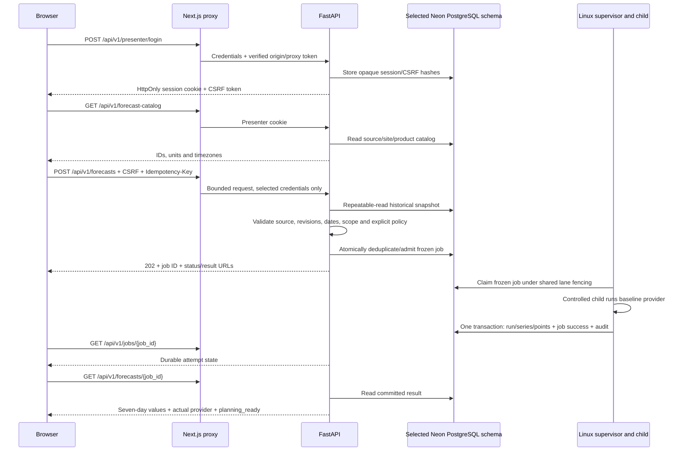

# Forecast API: implemented flow and verification (PP-45 / #29)

This is the bounded baseline implementation on VP, based on V5 §§4–7/12–13 and
the accepted operational contract. It supersedes older **implementation-status**
statements saying health is the only route. It does not close all V5 acceptance,
qualify Chronos, implement CSV import, merge or_pipeline, or complete #67/#68.
Historical Google Docs are references; this is not a claim that every tab was
freshly fetched. User authorization: build the forecasting API end to end and
document/check the flow; GitHub #29 now includes VaishnaviPhadtare.

## Request and response flow



No inference runs in POST admission, startup, health, catalog, polling or result
reads. The child receives bounded frozen JSON and no database credentials. The
supervisor, not an HTTP background task, owns execution, deadlines and publication.

Connections select the explicitly configured schema with `SET LOCAL search_path`
at each transaction start. This supports the selected Neon transaction pooler,
which rejects `search_path` startup options, and does not leak a schema choice to
the next borrower of a pooled server connection. TLS/security URL parameters stay intact.

## Data and policy boundaries

- Select exactly one existing `data_sources.id`; this is the initial dataset
  boundary. Tenant and actor come from the server-verified presenter session.
- Read `demand_records`/`demand_revisions`, complete `receipts`/
  `receipt_revisions`/`receipt_lines`, reporting coverage, and versioned calendars.
  Keep requested/fulfilled/unmet nulls. Fulfilled proxy and mixed history require
  explicit policy flags. Reporting coverage supplies genuine donation zeros.
- Latest visible receipt revision is selected **before** corrected site/date
  filtering. A void supersedes the old receipt and remains in frozen provenance;
  it contributes no donation quantity. Actual receipts never become future supply.
- Freeze the current active configured catalog, concrete calendar IDs, units,
  exact fact revisions, local cutoff and knowledge cutoff. This is not a historical
  reconstruction of earlier site activation flags. Reject catalog/calendar records
  not yet visible at the knowledge cutoff and conflicting historical timezones.
- Require all active beneficiaries and hubs/products; hub demand is excluded.
  The bounded network accepts 6–18 beneficiaries and 1–2 hubs (20 total max), with
  1–20 active products. The demonstration has **six beneficiaries, one hub, two
  products: 12 demand + 14 donation series = 26 series / 182 future points**.
- Request history spans 7–366 days. Limit selected raw rows, prepared observations,
  serialized input/output and HTTP bytes. Fail explicitly at bounds. Reject source
  integer quantities or same-day receipt sums above 2^53 before conversion to the
  existing floating-point provider contract; stock remains BIGINT.
- Policy must be supplied: strategy, sparse calendar window and minimum samples.
  There are **no new production sparse-history defaults**. Demo policy (14 days,
  three samples) is labeled as a fictional example. `CHRONOS2` is rejected by the
  baseline HTTP contract while actual model qualification remains paused.
- Seasonal naive and moving average preserve raw forecast precision. Baseline
  quantiles are null, with honest POINT/MEAN and provider identities. When explicitly
  allowed, classified primary failure/timeout permits a supervised **whole-batch**
  moving-average fallback, labeled per series and with the failure reason. A bug
  cannot enable substitution. Incomplete results remain readable but not planning-ready.
- Forecasting does not read or mutate physical inventory. Donation predictions do
  not create stock or confirmed arrivals. VP's inclusive expiry/non-expiring rules
  remain unchanged; OR branch expiry/audit convergence stays separate.

## Persistence, reuse and planning handoff

`pp45_0004` follows the existing combined head; it adds `forecast_runs`,
`forecast_series`, `forecast_points`, and `presenter_sessions`, plus tenant-scoped
queue identity constraints. Previous applied revisions remain unchanged.
Published forecast rows reject UPDATE/DELETE. The run stores the exact frozen input
and output; normalized series/points retain their per-series details and dates.

`QueueRepository.publish` fences owner/generation/token/attempt/deadline/input and
commits all result rows, SUCCEEDED, audit and slot release together. An exception
rolls everything back. `planning_ready` becomes externally visible only in that
committed transaction, and only if every required series is available.

Admission's shared lane lock serializes exact-input lookup and insertion. Repeated
idempotency keys replay; changed payload under the same key is 409. Identical active
jobs and committed planning-ready results share one job even with different keys.
Reuse preserves original timestamps/providers. Failed/cancelled/stopping/incomplete
results are not reused. Explicit `force_refresh=true` bypasses reuse and creates a
new job on a new key. A retry is explicit and retains the original frozen input.
Worker outage does not prevent saved reads or exact committed reuse; new computation
fails 503. Inventory changes are absent from forecast identity.

`read_committed_forecast` is the internal planning read adapter: require committed
job/attempt success and planning readiness, revalidate frozen input/output, return
original precision. Existing `freeze_handoff` applies the scenario's chosen estimate
and ceilings each day once. Binding this adapter to or_pipeline still needs its
cross-branch convergence; this change does not claim an integrated allocation API.

## HTTP surface and access

| Method and route | Purpose |
|---|---|
| GET `/api/v1/health` | Process liveness; never a compute-readiness claim |
| POST `/api/v1/presenter/login` | Configured demo presenter; 8-hour opaque session |
| POST `/api/v1/presenter/logout` | Revoke session and clear cookies |
| GET `/api/v1/forecast-catalog` | Authenticated source/site/product IDs |
| POST `/api/v1/forecasts` | Freeze and durably admit/reuse; 202 with explicit state |
| GET `/api/v1/jobs/{job_id}` | Authenticated scoped status/attempt summaries |
| POST `/api/v1/jobs/{job_id}/retry` | Manual retry with original frozen input |
| POST `/api/v1/jobs/{job_id}/cancel` | Idempotent cancellation; may remain STOPPING |
| GET `/api/v1/forecasts/{job_id}` | Committed result; owned/unpublished is 409, missing/other tenant 404 |

Mutations require an allowed origin, session and CSRF token; login has bounded
local rate limiting. All mutation commands require `Idempotency-Key` except session
login/logout. Error envelopes include a server-generated request ID and redact
request bodies, passwords, database URLs and SQL errors. HTTP bodies are ≤64 KiB.
The Next route allowlists these paths, checks same origin on mutations, forwards
only presenter/CSRF cookies and command headers, adds its server-only proxy secret,
and preserves backend cookies/status/Location/request ID. No browser secret uses
`NEXT_PUBLIC_`. Authentication follows the OR branch's provisional cookie/config
conventions; merging its migrations still requires #67 reconciliation.

## Running the bounded demo

Use the user's selected Neon project/branch and existing private `.env` URLs. Never
use the older commented connection. Migrations/seeding are deliberate commands;
startup and GET never create tables or seed data.

**Prepared locally on October 25:** `pp45_demo_vp_20261025` exists inside the selected
Neon database, with migrated tables and fictional history. `public` remains at
`pp21_0002`. Private API/web environments select the new schema and local presenter;
the generated request and login details are in ignored
`artifacts/forecast-api/request.json` and `artifacts/forecast-api/local-access.json`.
These private files are never part of the Git change. No forecast results were
fabricated in that persistent demo: its live worker is still unavailable.

For direct local API exploration, from `apps/api`:

```powershell
.\.venv\Scripts\python.exe -m uvicorn app.main:app --host 127.0.0.1 --port 8000 --env-file .env
```

The temporary real-HTTP smoke starts and stops its own loopback API process:

```powershell
.\.venv\Scripts\python.exe scripts/smoke_forecast_http.py --env-file .env --access-file ../../artifacts/forecast-api/local-access.json
```

It verified login/catalog against the configured **pooled** Neon connection and the
truthful worker-unavailable submission response; it does not impersonate a worker.

1. Use `scripts/load_forecast_demo.py --schema pp45_demo_<name> --request-file <path>`
   with an explicit direct `DATABASE_URL_UNPOOLED`. This creates a new isolated schema,
   migrates it and loads fictional 90-day operational history atomically. Existing
   schemas/data are never reset. Keep the request file under ignored `artifacts/`.
   Simulated historical knowledge timestamps are fixture metadata, not a claim that
   observed production data was known before import. Stock is not seeded by this loader.
   On Windows, `--stdout | Set-Content -Encoding utf8 <path>` lets PowerShell write
   the public request manifest if native Python file creation is restricted.
2. Set API/worker `PP_DATABASE_SCHEMA` to that schema. Configure
   `PP_PRESENTER_ORGANIZATION_ID` from the generated file, `PP_PRESENTER_USERNAME`,
   `PP_PRESENTER_PASSWORD_HASH` (scrypt 16384/8/1, random ≥16-byte salt, 64-byte digest;
   format `scrypt$16384$8$1$<salt-hex>$<digest-hex>`), `PP_ALLOWED_ORIGINS`, and a random
   `PP_TRUSTED_PROXY_TOKEN`. Cookie security defaults true; false is permitted only
   for local HTTP development. No default presenter/password is shipped.
3. Configure the web server's `PANTRYPULSE_API_ORIGIN=http://127.0.0.1:8000` and matching
   `PP_TRUSTED_PROXY_TOKEN` in its private environment.
4. Linux: `docker compose -f compose.forecast.yaml up --build` runs API + production
   worker, both reading `apps/api/.env`. Alternatively run the existing API and
   `python -m app.workers.supervisor --registry production` in the locked Linux runtime.
   Hosting/Chronos setup is not resumed by adding these local commands.
5. Login through the same-origin proxy, use its CSRF token, POST the generated
   `request` with a new idempotency key, poll `status_url`, read `result_url`.
   Swagger at the backend `/docs` can test direct requests with allowed Origin and
   cookies/CSRF; missing worker capability correctly returns 503.

## Evidence and limits

Final implementation checks (October 25, local VP working tree):

| Check | Observed result |
|---|---|
| Backend `pytest tests --ignore=tests/integration -q -p no:cacheprovider` | **817 passed, 11 Linux-only tests skipped** |
| PostgreSQL forecast/operational/stock modules, isolated-schema opt-in | **44 passed**, including complete publication, rollback after inserts, cancellation fence, parallel dedup, latest forced-refresh reuse, immutable rows, insufficient-history exclusion, manual retry/cancel/logout and prior migration/stock regressions |
| Backend Ruff, changed scripts/tests | Passed |
| Offline OpenAPI `export_openapi.py --check` | Matches checked-in schema |
| Generated TypeScript `openapi-typescript ... --check` | Matches checked-in types |
| Node proxy origin/path/byte/header/cookie checks | **1 passed** |
| Frontend TypeScript | Passed |
| Frontend ESLint | Passed |
| Temporary real loopback HTTP, configured pooled Neon | Login **200**, catalog **200** / 7 sites / 2 products / 1 source; forecast admission **503 COMPUTE_UNAVAILABLE**, as expected without a worker |

The API/storage checks use the actual baseline handlers and 26-series fixture;
they do not count the test heartbeat as a live production supervisor. Existing
Starlette/httpx deprecation and Node module-format notices do not hide test failures.
Independent verifier review has not been established in this turn.

Native Windows has no supported process-containment driver. WSL reports not installed
and Docker is unavailable on PATH. Direct handler + HTTP + PostgreSQL tests are
**not evidence of a running Linux supervisor**. Keep the job's live-worker gate;
do not fabricate a heartbeat or run synchronous inference to make POST appear ready.
Full Linux worker smoke, actual Chronos inference, CSV ingestion, dashboard binding,
OR branch convergence and complete V5 release acceptance remain distinct gates.
