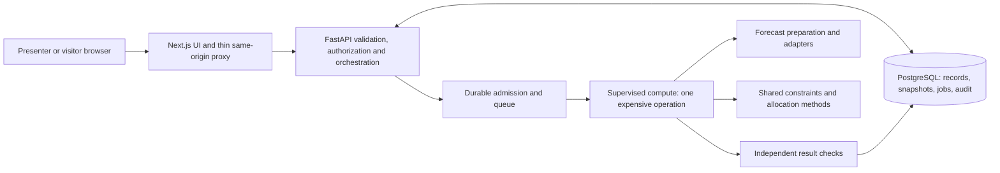

# PantryPulse — Project Specification V5

> OR reviewed checkpoint (October 24, 2026): bounded SIMULATED OR implementation is committed at `e49e360`; subsequent review fixes, real browser rehearsals and measured local benchmark evidence are in the [reviewed checkpoint](../optimization/CHECKPOINT-REVIEW-2026-10-24.md) and [acceptance ledger](../optimization/ACCEPTANCE.md). Baseline status descriptions below remain historical. OR-DEC choices remain provisional; UI acceptance, LIVE publication/adapters and paused supplier/model work remain incomplete.


**Version:** 5.0 · **Consolidated:** October 24, 2026, America/New_York  
**Purpose:** the project source of truth for product scope, accepted decisions, implementation status, contracts, unresolved work and acceptance.  
**Status:** consolidated specification with explicit implementation gates. The complete product is not implemented or release-ready.

**Code baseline:** `main` / `origin/main` at `5d2012e`; merged backend primitives entered through PR #7 at `0244ef1`. **Additional reviewed work:** `origin/forecasting` at `bed08544e3dc9b00499224806d92dd8f437f0644`, not merged into this main baseline. Their common ancestor is `a0ad11f45bb15a3c3158ed6678f9522652d2a723`. The forecasting branch was inspected and tested in an isolated copy, without modifying or integrating it.

**Authority and reading copy:** This repository Markdown file is the source of truth. The [Google Docs v5 tab](https://docs.google.com/document/d/1WcsV69YCE1mqW2pI7IyEFQBSuwQB_hMhVQKfU20ZFk8/edit?tab=t.phiita8avpoe) is a reading copy; proposed changes there must be reconciled into this file before they change the project specification. The tab was empty at the original consolidation inspection. Source material includes [V4 and working tabs 00–07](https://docs.google.com/document/d/1WcsV69YCE1mqW2pI7IyEFQBSuwQB_hMhVQKfU20ZFk8/edit?tab=t.951hp1xdarlq).

## Contents

1. [Authority and reading rules](#1-authority-and-reading-rules)
2. [Product, users and scope](#2-product-users-and-scope)
3. [What exists today](#3-what-exists-today)
4. [Architecture and ownership boundaries](#4-architecture-and-ownership-boundaries)
5. [Domain data, history and stock integrity](#5-domain-data-history-and-stock-integrity)
6. [Forecasting requirements and existing implementation](#6-forecasting-requirements-and-existing-implementation)
7. [Evaluation and forecast qualification](#7-evaluation-and-forecast-qualification)
8. [Frozen scenarios and transfer modes](#8-frozen-scenarios-and-transfer-modes)
9. [Inventory projection and common feasibility](#9-inventory-projection-and-common-feasibility)
10. [Research policy and allocation mathematics](#10-research-policy-and-allocation-mathematics)
11. [Supplier replenishment](#11-supplier-replenishment)
12. [API, access and public contracts](#12-api-access-and-public-contracts)
13. [Durable computation, limits and observability](#13-durable-computation-limits-and-observability)
14. [Frontend, explanations and interaction](#14-frontend-explanations-and-interaction)
15. [Runtime, setup and deployment](#15-runtime-setup-and-deployment)
16. [Validation and release acceptance](#16-validation-and-release-acceptance)
17. [Delivery sequence](#17-delivery-sequence)
18. [Accepted decision register](#18-accepted-decision-register)
19. [Open, deferred and paused work](#19-open-deferred-and-paused-work)
20. [Reconciled conflicts](#20-reconciled-conflicts)
21. [Sources and maintenance](#21-sources-and-maintenance)

## 1. Authority and reading rules

V5 consolidates the existing work rather than approving new product policies. Use the following precedence:

1. Explicit subsequent user decisions, recorded with date and affected decision IDs.
2. Accepted requirements and resolutions in V5, including **BD-41**, which supersedes the earlier single-topology selection.
3. Detailed October 24 backend decisions/contracts and reviewed architecture decisions, where compatible with V5.
4. V4's authoritative extensions and the working module guides derived from them.
5. Older V1–V3 material, embedded handbook copies, examples, templates and historical plans, only where compatible.

Implementation evidence answers **what exists**, not **what policy was approved**. Experimental code cannot silently close an OPEN decision. A newer documentation commit also cannot undo an earlier explicit user decision merely by repeating old wording. This distinction matters for the forecasting branch's experimental policies and recently published setup guides.

Use these status terms consistently:

| Status | Meaning |
|---|---|
| ACCEPTED | Binding product/design direction; may still need detailed contracts and implementation |
| IMPLEMENTED — MAIN | Present in the inspected main baseline |
| IMPLEMENTED — BRANCH | Present only in the identified unmerged branch |
| VERIFIED — bounded scope | An identified command/check passed for the stated tree, environment and capability |
| EXPERIMENTAL | Working internal configuration or contract pending shared adoption |
| OPEN / PARTIAL | Missing specification or integration needed before the dependent feature |
| DEFERRED | Alternatives deliberately retained without selecting one |
| PAUSED | Do not resume the named work until the user resumes it |
| UNVERIFIED | No adequate execution evidence; neither success nor infeasibility is established |

The public contract, operational schema, full objective policy and research-validation gate remain incomplete. This is a source of truth that names those gaps, not a claim that every feature is immediately implementable.

## 2. Product, users and scope

PantryPulse is a simulated food-distribution decision-support platform for Gator Hack V, October 23–25, 2026. It helps a coordinator inspect usable stock, forecast demand and donated supply, identify dated shortages, and compare feasible allocation plans under different priorities.

The central contribution is a working **CLASSICAL_GP versus EGP_PI_INSPIRED** comparison on identical operational inputs. The research method must make institutional vulnerability and absolute/relative deprivation affect actual allocation decisions. Forecasting, inventory, FEFO, procurement proposals and visualization support that comparison.

Primary users are a network coordinator, site manager and analyst. For the demo, one authenticated presenter can perform their mutation/submission roles; visitors inspect saved synthetic data and results. Transport volunteers and a future procurement manager are supporting personas, not separate implemented permission systems.

The complete intended journey is:

1. Seed or import fictional operational history, donations, lots and documented vulnerability indicators.
2. Generate or deliberately reuse seven-day demand and donation forecasts with actual provider/provenance metadata.
3. Inspect dated stock, expiry, demand, service and shortages.
4. Create a fully frozen scenario with an explicit transfer mode and policy.
5. Compute both allocation methods against that same snapshot and feasible region.
6. Inspect changed allocations, residual need, AP/RP measures, costs, waste and limitations.
7. Change a disruption or policy, create a new frozen scenario and recompute while preserving prior evidence.
8. Mark a plan reviewed as a simulation; use a protected, isolated reset for rehearsal.

### 2.1 Required scope

| Area | Required outcome |
|---|---|
| Population | At least six fictional beneficiary institutions, one or two hubs, two products/resource categories with explicit base units |
| History and forecasts | Daily demand and received-donation histories, seven future local dates, mandatory seasonal baseline and permitted fallback |
| Stock | Expiration-dated lots, eligibility, hard FEFO, confirmed arrivals, controlled corrections, versioned ledger/audit integrity |
| Research | Prepared vulnerability scores, active AP/RP goal terms, weighted/Chebyshev objective, conventional comparator, independent mathematical evidence |
| Planning | Fully frozen inputs, both explicit transfer modes, shared constraints, independent result verification and replay |
| Product | Typed backend, durable jobs, presenter controls, accessible comparison and scenario interaction, truthful failure states |
| Supplier proposals | Accepted draft-proposal scope with coordinated simulated budget and after-arrival coverage; dependent design/implementation remains paused |
| Release evidence | Real PostgreSQL/API/solver integration, full browser journey, repeatable reset, measured limits and disclosed omissions |

Chronos-2 is preferred where demonstrated feasible and qualified separately. A live baseline core can be demonstrated with Chronos explicitly unverified. An unfinished research method cannot be described as a completed research comparison. Completing the accepted supplier scope requires later resumption and implementation or an explicit scope amendment; it is not silently reclassified as optional.

### 2.2 Later or unapproved capabilities

P1 includes operational approval/reservation/completion, fuller multi-period research fidelity and endogenous weighting, roles beyond the demo boundary, calibrated intervals, evaluated ensembles, richer routing, discrepancy/reliability automation and production operational workflows. Real procurement/payment/dispatch, live partner integrations and food-safety assurance are outside P0.

The Google Doc's **Q-Discuss** tab proposes one planning agent using Microsoft Agent Framework and Gemini to invoke backend tools. It is a discussion proposal, not an accepted dependency or implemented capability. Any later assistant may explain or submit authorized tool requests; it must not replace forecasts/OR-Tools, approve purchases, bypass presenter permissions or directly alter stock. No framework/model selection is adopted by V5.

## 3. What exists today

### 3.1 Integrated main baseline

| Component | Inspected state and boundary |
|---|---|
| Frontend | Static Next.js development landing page, shared styling/tokens, configured component registries and one scaffold Playwright test; no dashboard, API client, proxy or interactive comparison |
| API | FastAPI exposes only `GET /api/v1/health`; response is exactly `{"status":"ok","scope":"process"}` |
| BE-01 | Strict `TransferMode` and `AllocationMethod` enums; immutable required-mode schema fragment with no default or unknown fields |
| BE-02 | Pure role/mode route permission with rejection precedence; permission is not shipment feasibility |
| BE-03 | Exact `Decimal` upward rounding per dated demand estimate, then summation |
| BE-04 | Exact rational downward quantization at scale 10,000, with int64 output check |
| BE-05 | Native solver-status gate before candidate/vector access; no solver is executed |
| BE-06 | Daily history alignment retaining observed zero, absent source and explicit null separately |
| Optional Chronos exercise | Separate Dockerfile/Compose runner, synthetic input, checkpoint preparation/pinning, session/smoke/benchmark commands and eight safeguard tests; actual image build/model execution unverified |
| Persistence/contracts | SQLAlchemy/Alembic dependencies and directory boundaries; no domain ORM, Alembic revisions, domain repositories or generated public TypeScript |
| Execution/research | No durable scheduler, supervisor, heartbeat, complete stock projection, allocation engine or complete independent solution checker |
| Setup | Frozen manifests/locks, Windows setup/doctor scripts, local database/API Compose, separate Neon-demo Compose, Cloudflare and optional hosting guides |
| CI/gates | Quick-gate configuration exists and is enabled. GitHub Actions is a `.yml.template`; full product gates reference missing commands/tests |

The six helpers were integrated through PR #7. Their task packets preserve bounded test evidence and explicitly say the independent verifier pass was not completed. Merged/tested does not imply independent research or product acceptance.

### 3.2 Unmerged forecasting branch

Branch: [`forecasting` at `bed08544e3dc9b00499224806d92dd8f437f0644`](https://github.com/gbw30/PantryPulse/tree/bed08544e3dc9b00499224806d92dd8f437f0644). At inspection, main had 15 commits not on that branch and the branch had one commit not on main. It includes **36 changed files** relative to their common ancestor. No merge was performed for V5.

| Branch modules | Implemented offline behavior |
|---|---|
| `forecasting/schemas.py` | Frozen experimental Pydantic contracts, exact scope/ownership references, missingness, estimate/quantile validation and computational coverage |
| `preparation.py` | Named dataset, exact visible revisions, data/knowledge cutoffs, receipt aggregation, coverage-backed observed zeros, explicit gaps and proxy policy |
| `adapters/seasonal_naive.py` | Calendar-based prior-weekday forecast |
| `adapters/moving_average.py` | Explicit trailing calendar window and minimum observed samples; point-only mean |
| `adapters/chronos2.py` | Dependency-free unavailable boundary; **no real Chronos inference** |
| `service.py`, `postprocessing.py` | Seven dates, classified provider fallback, actual provider per series, output rejection, exact-result reuse eligibility |
| `evaluation.py` | Chronological folds, truth cutoff, coverage/failure accounting, MAE/bias/WAPE and common scored sets |
| `handoff.py` | Frozen forecast-derived demand, exclusions, explicit central/conservative choices, daily ceiling and content hash |
| `inventory/projection.py` | Pure supplied-lot/confirmed-arrival FEFO and daily lost-sales projection under experimental time/expiry rules |
| Fixture/evaluation scripts | Six beneficiaries, one hub, two products, 90 days, 26 required series and synthetic evaluation evidence |

These modules do not implement public endpoints, database publication, stock posting, complete operational scenarios, durable jobs, deadlines, authentication or allocation. `ready_for_publication` is computational completeness; it is not committed `planning_ready`.

**Review-fix candidate:** The `codex/pr49-pr50-review-fixes` branch combines PR #49 and PR #50 with review corrections. Its [PP-30 packet](tasks/PP-30-pr-review-fixes.md) records current verification. The original main/branch evidence below remains the consolidation baseline, not a claim that this candidate has already merged.

### 3.3 Evidence at consolidation

| Check | Result | What it establishes |
|---|---|---|
| Main `npm run check`, run in this working session | PASS: web types/lint, API Ruff, **437 API tests** | Main scaffold/helpers and standalone safeguards, not domain integration |
| Main `npm run test:config` | PASS: **17 tests** under normal Git permissions | Hook/configuration behavior |
| Main optional Compose validation, local links and PowerShell examples | PASS | Configuration/syntax/link validity; no services or models were started |
| Forecast branch API tests from isolated extracted tree, existing Python 3.12.13 environment | PASS: **44 tests**, one existing Starlette TestClient deprecation warning | Offline branch behavior; not the full branch dependency/runtime qualification |
| Forecast branch evaluation script | PASS: **182 forecast points**, 26 required series, four historical folds, **728 scored pairs per compared strategy** | Reproducible synthetic baseline evaluation only |
| Real Chronos inference, domain DB/API, durable jobs, both allocation methods, judge workflow | UNVERIFIED / NOT IMPLEMENTED as described above | No release claim |

Sandbox-only test stalls/temporary Git permission failures were resolved by authorized reruns; they are not product failures. Earlier build, database-runtime and one-test Playwright records remain historical evidence at their original scope. None was reclassified as a fresh full-product run.

## 4. Architecture and ownership boundaries

One Next.js application, one modular FastAPI backend and PostgreSQL form the product. Expensive work runs under controlled supervision; a dedicated queue vendor or second backend is not selected.



This diagram is the **target architecture**, not a diagram of implemented routing. Keep cheap reads and polling outside the expensive slot. Forecasting and solving must not run on startup, probes or GET. A forecast is generated separately and supplied immutably to allocation; an optimizer must not call a model while solving.

| Path/boundary | Responsibility |
|---|---|
| `apps/web` | Presentation, interactions and thin proxy; no authoritative inventory/forecast/objective calculations |
| `apps/api/app/routers`, `schemas` | Validated versioned HTTP contracts and authorization |
| `models`, `repositories`, `migrations` | PostgreSQL integrity, immutable publication, revisions and transactions |
| `services/forecasting` | Preparation, provider adapters, evaluation and forecast handoff |
| `services/inventory` | Ledger-derived availability, dated eligibility/service and projection |
| `services/optimization` | Shared feasible region, policy, classical/research objectives, independent metrics/checks |
| `packages/contracts` | Generated OpenAPI/TypeScript boundary after public contracts are finalized |
| `data/demo` | Deterministic simulated fixtures; historical and expanded fixtures clearly separated |
| `scripts/quality`, tests | Meaningful checks and source-bound evidence |

Module ownership does not imply microservices or fixed assignments among human contributors. Integrate reviewed, bounded work against a recorded base. Do not modify another active worktree or infer that branch code is already available on main.

## 5. Domain data, history and stock integrity

### 5.1 Required logical records

The following information is required. Concrete database names, columns, precision/bounds, indexes and public field names remain gated by OPEN-04–11/29. Existing example SQL is not a finalized migration.

| Record | Required meaning |
|---|---|
| Organization/site | Ownership, identity, role, activity and applicable operational timezone; optional geographic metadata |
| Product/category | Standardized product, compatible category, explicit base unit and applicable handling coefficient |
| Inventory lot | Site/product, physical quantity, eligibility, receipt/expiry, commitments where applicable, source/version |
| Demand revision | Site/product/local day; requested, fulfilled and unmet quantities when known; source/revision/provenance |
| Donation receipt/revision/lines | Donor distinct from receiving site; actual received instant/local day; products/quantities and complete event revision |
| Reporting coverage | Evidence that donation reporting for a local day is complete, needed to distinguish no receipt from unknown reporting |
| Ledger/audit event | Identified stock change, actor/time/reason, source linkage, inventory version and duplicate-operation protection |
| Expected supply | Destination/product/arrival/quantity, confirmation/receipt state and source-event linkage |
| Forecast run/series/points | Requested strategy, actual provider/configuration, frozen inputs, seven dated results, quality/outcome/fallback/evaluation |
| Scenario/snapshot | Required mode, selected scope, exact source versions, frozen assumptions/policy/operational inputs, schema version and hash |
| Policy/attributes | Prepared scores, raw/source information, coefficients, groups, numerical rules, provenance and immutable versions |
| Plan/transfers/goals/metrics | Method and native status, snapshot/settings, lot-level recommendations, service/shortfall/deprivation and diagnostics |
| Supplier offers/baskets | Manual/seeded terms, conditional coordinated proposal, alternatives and uncovered need; incomplete paused contracts |
| Job/attempt/review | Durable lifecycle and ownership, input/result links, manual retry history and review without stock effects |

Use UUID identities and enforce consistent organization ownership in application and database contracts. Store event/record timestamps in UTC; resolve operational days under versioned site timezones. Meals and bottles are different quantities. Never add them into an unlabeled inventory, demand, service or unmet total. Shared transport capacity uses explicit handling units, not implicit substitution.

### 5.2 History, corrections and receipts

Requested demand is the prediction target. Fulfilled units can be censored by stockouts and cannot silently substitute for demand. Unknown components stay unknown. Where all three are observed, requested = fulfilled + unmet; supplied values must be finite/nonnegative and internally consistent.

Retain daily demand totals and individual donation receipts. Donation forecasting means **actual received quantity by receiving site/product/local day**, not offered/pledged/forecast supply. Distinct same-day receipts must aggregate once. Keep source classification, such as OBSERVED/SIMULATED, separate from target basis, such as REQUESTED/FULFILLED_PROXY/RECEIVED.

Accepted rules:

- Historical imports do not change current stock.
- Corrections append revisions and preserve originals; saved inputs retain the exact revisions used.
- A new receipt changes stock only through an explicit, exactly-once posting transaction linking receipt, lot, ledger, inventory version and audit.
- At posting, the operator declares lot eligibility and records actor/time/reason. Unknown status is held/unavailable. These labels do not establish food safety.
- Partial imports may accept valid demand rows and complete valid receipts; a receipt and its lines succeed or fail together. Return precise row/field errors and accepted/rejected counts.
- Already-posted corrections require linked audited stock adjustments, including explicit consumed-stock handling. Duplicate identity, reversal/cancellation and idempotency semantics need final contracts.

### 5.3 Physical stock and expected supply

Baseline planning includes eligible current stock and qualifying confirmed arrivals. Received supply must leave future-inbound accounting when it enters on-hand stock. Forecast donations, canceled supplies and unapproved supplier proposals cannot become confirmed stock by label or arithmetic.

Mutations must preserve nonnegative balances, unit compatibility, expected-version checks and atomic ledger/audit consistency. Exact ledger authority, lock/version scope, reservation subtraction, idempotency-key reuse and rollback rules remain OPEN-09. Counts/discrepancies are separate from corrections; their first-release scope remains OPEN-11.

Expired lots remain auditable records. A date cutoff excludes use; it does not delete history or guarantee safety. Operational arrival/expiry/timezone ordering and missing-expiry rules remain OPEN-06/21 despite the experimental projection described below.

## 6. Forecasting requirements and existing implementation

### 6.1 Shared service requirements

A series is identified by organization, site, product, target type and unit/calendar context. DEMAND and DONATION stay distinct. Produce seven unique, ordered future local dates for every successful required series. Failure or missing required coverage cannot silently turn into zero or a smaller complete-looking scope.

Demand forecasts represent predicted need, not net shortage. Current inventory enters the dated projection; subtracting stock from stored demand forecasts would corrupt reuse, evaluation and controlled comparisons.

`ForecastInput`, `ForecastOutput`, `DailyObservation` and `ForecastPoint` are **application contracts**. A provider adapter converts them into the provider's native data format. Provider-specific DataFrames, model loading and checkpoint operations do not belong in the UI or HTTP request contract.

Required metadata includes exact source revisions, data cutoff, knowledge/as-of cutoff where applicable, required/excluded series, source/basis labels, missingness and quality diagnostics, strategy, provider/checkpoint/package/adapter versions, preprocessing/inference/grouping settings, dates, actual fallback reason and original generation time. Public outcome enums and SQL/wire representations are not finalized.

Preserve historical gaps; do not interpolate, forward-fill, zero-fill or clip original observations. Explicitly opted-in fulfilled proxies are separate from missing-date repair. Future covariates must be known or explicitly forecast at the prediction origin, with provenance. A typed covariate catalog and pinned Chronos-native missing-value behavior remain OPEN-15.

### 6.2 Offline branch contracts and policies — experimental

The branch uses frozen Pydantic models, immutable nested tuples and `experimental-v1` schema labels. Its `Quantity` is a finite nonnegative strict floating-point value. Main's numerical primitives accept exact `Decimal`/`Fraction` values. SQL quantity precision and the bridge between these representations are still OPEN-04/24; integration must not assume they are identical contracts.

| Branch rule | Current behavior | Adoption boundary |
|---|---|---|
| Revision selection | Highest visible revision number per named dataset/logical fact; duplicate revision identities fail | Operational revision/coverage policy still OPEN-07 |
| Availability | `recorded_at <= snapshot_as_of`, then operational day through data cutoff; corrected events moved beyond cutoff do not revive old revisions | Do not claim an as-of backtest from retrospectively corrected inputs without labeling it |
| Receipt aggregation | Complete event revisions and line sets; receiving-site/product/day sums; donor/header content retained | Repository ownership and posting transactions not implemented |
| Observed zeros | Complete reporting coverage plus no receipts yields zero; no coverage/no receipt stays missing; incomplete observed sums carry a warning | Coverage source/authority requires shared review |
| Proxies | Fulfilled proxy requires explicit permission; mixed requested/proxy history needs a second opt-in | No automatic proxy or imputation default |
| Identity | Canonical UTF-8 JSON, sorted keys/collections, compact separators, ISO dates/UTC times, no NaN, SHA-256 | Execution IDs/times excluded from forecast input identity; knowledge cutoff included; full scenario schema still OPEN-19 |
| Publication | All required series AVAILABLE implies `ready_for_publication` | Only a future atomic database publisher may claim committed planning readiness |

All historical components/masks and full selected fact content remain frozen. Two inputs whose receipt totals match can still have different identities because donor/header/revision facts differ. A pure hash comparison does not prevent concurrent duplicate submissions in PostgreSQL.

### 6.3 Baselines, fallback and output interpretation

The implemented weekly baseline uses `prediction(T+h) = observed(T+h-7)` for h=1…7, using real calendar dates and retaining true zeros. Missing any required reference produces an insufficient-data provider outcome; it does not pick the last seven array values.

The branch's sparse method computes the mean of observed values within an explicitly selected trailing calendar window and repeats it over seven dates. The expanded fixture selects **14 calendar days / at least 3 observed values**. This is an experimental fixture policy, not an approved production default. Older seven-available-observation examples do not override it or close OPEN-13.

Only classified provider failures permit fallback. The implemented chain is Chronos → seasonal naive → moving average when fallback is allowed; seasonal naive can fall back to moving average. Invalid application input and programming errors must not be concealed as successful provider substitution. If no usable candidate exists, retain an explicit unavailable/failed series with errors and no fabricated points.

| Output kind | Required interpretation |
|---|---|
| Seasonal-naive point | `estimate_kind=POINT`; no invented p50 or bounds |
| Moving average | `estimate_kind=MEAN`; mean is not a median |
| Actual model median | `estimate_kind=MEDIAN` only when supported; central estimate equals p50 |
| Raw model quantiles | Identify actual available p10/p50/p90 and `MODEL_QUANTILES`; no calibration claim |
| Point-only uncertainty | Null quantiles and `interval_method=NONE`; no shaded fake interval |
| Conservative buffer | Explicit scenario assumption, never a stored model quantile or stockout probability |

The branch rejects negative/nonfinite predictions, wrong/duplicate dates and crossed quantiles. These are experimental adapter validation rules pending the public contract. The standalone main Chronos exercise instead retains raw negative quantiles with a warning: those raw outputs are diagnostic artifacts, **not valid integrated planning outputs**. Integration must resolve that difference explicitly.

### 6.4 Reuse, recomputation and conservative handoff

Reuse exactly matching immutable results by default, preserving original timestamps/provider/fallback metadata. A deliberate forced recomputation creates new execution/result identities. Public cache/deduplication/retention and fallback-reuse rules remain OPEN-17.

Changes to observations, revisions, scope, cutoff, units/calendar, preprocessing, covariates, model/revision or relevant inference settings can require new forecasts. Changes only to inventory, routing or allocation priorities require a new scenario/allocation, but need not repeat unchanged forecasting.

For conservative demand, use an available upper quantile or an explicit presenter-selected buffer when it is absent. The branch uses p90 first, otherwise `central × (1 + buffer_fraction)`. It selects no public buffer default/upper bound. Preserve null quantiles and label each series' choice. Sum of daily p90 values is not a joint 90% bound or stockout probability.

Apply the selected scenario estimate first, **ceil each day once, then sum** for the allocation window. Preserve original estimates. Thus 0.2 and 0.2 become daily integer targets 1 and 1, total 2. The branch handoff freezes forecast-derived demand only; it does not freeze the complete operational scenario.

### 6.5 Actual Chronos qualification

`chronos-forecasting` 2.3.2 is locked as an optional dependency. A lockfile does not qualify a checkpoint, missing-data handling or real inference. The branch adapter raises `PROVIDER_UNAVAILABLE` without importing/downloading the model. Successful fallback from this boundary is baseline evidence.

Main's separate runner in [CHRONOS-LOCAL.md](../../CHRONOS-LOCAL.md) prepares a pinned `amazon/chronos-2` revision, uses CPU/float32, retains a model-file cache, and provides actual session/smoke/benchmark commands once setup is resumed. Its standalone synthetic exercise has **16 series / 112 future rows**, distinct from the branch's **26 series / 182 rows**. It is not the integrated provider or a replacement for full-scope qualification. No actual model execution has been established.

After explicit resumption, qualify the real package/checkpoint/revision, native input/gap behavior, ID/date mapping, raw quantiles, valid postprocessing, actual failure containment, cold/warm timings, resources and comparative accuracy. Record the complete required scope. Cached replay, mocked providers, imports and process health do not establish this capability.

## 7. Evaluation and forecast qualification

Use chronological origins and separate training/knowledge and held-out truth cutoffs. Freeze everything used at each origin; preprocessing, model selection and any future ensemble fitting must not see later outcomes. Retain failure/coverage counts so a method that emits fewer forecasts cannot appear better just because difficult cases disappeared.

For n scored points, error = prediction − actual:

```text
MAE  = sum(abs(error)) / n
bias = sum(error) / n                 # positive means overprediction
WAPE = sum(abs(error)) / sum(actual) # ratio; unavailable if actual total is zero
```

With no scored pairs, all three metrics are unavailable. Keep demand and donation, product/unit, actual target basis and provider cohorts separate. Compare strategies on the same origin/series/day/unit/basis and identical truth. Preserve each full report's unavailable, missing-actual, basis-mismatch and fallback counts alongside the common scored set.

### 7.1 Reproduced branch experiment

All data is SIMULATED. The fixture contains Riverbend, Oak Terrace, Cedar Grove, Maple Crossing, Willow Creek and Pine Ridge pantries plus Gator Distribution Hub; products are meals and bottled water. It designates 12 beneficiary demand and 14 site donation series; hub demand is explicitly ineligible. It provides 90 local days beginning July 26, 2026, early gaps, an unknown requested day, same-day receipts, a late correction and coverage declarations.

Four origins at fixture offsets 61, 68, 75 and 82 yielded 728 scored pairs per strategy: 168 per demand/product cohort and 196 per donation/product cohort. The reproduced forecast input SHA-256 is `cc815438cc6e432f61bb46e8a777de40437d151f2a1a779653c1c0df9cb1f854`.

| Target/product | Seasonal MAE | Moving-average MAE | Seasonal WAPE | Moving-average WAPE |
|---|---:|---:|---:|---:|
| Demand, bottle | 0.25 | 3.451531 | 0.005719 | 0.078957 |
| Demand, meal | 0.25 | 3.451531 | 0.007000 | 0.096643 |
| Donation, bottle | 0 | 4.489796 | 0 | 1.428571 |
| Donation, meal | 0 | 3.265306 | 0 | 1.428571 |

WAPE values above are ratios, not percentages. The deliberately seasonal generator favors the weekly method; these results establish no real-world accuracy or Chronos performance. Run IDs and generated times change on recomputation; the frozen input identity is the stable reference. The branch's [committed evaluation summary](https://github.com/gbw30/PantryPulse/blob/bed08544e3dc9b00499224806d92dd8f437f0644/docs/pantrypulse/forecasting/evaluation.synthetic-v1.json) is retained evidence; the consolidation rerun reproduced the scope and metrics.

The branch does not implement automatic provider selection, untouched final holdout qualification, empirical interval calibration or live saved-read performance. Earlier product intent to choose the suitable method remains; exact windows, sample requirements and selection policy are OPEN-18. A worse Chronos result must be disclosed, and no existing forecast run may be retroactively relabeled.

## 8. Frozen scenarios and transfer modes

BD-09/10/41 require a scenario to be fully frozen at creation in a validated, schema-versioned JSONB package with a content hash and exact source/provenance references. Include selected forecast results, inventory/eligible lots, commitments, confirmed supplies, scope/exclusions, routes/ETAs/capacities, policy/attributes, assumptions and **transfer_mode**. Store model identity, not model weights.

Changing operational inputs, policy or mode creates a new scenario. Historical replay must not read mutable “latest” data. Old results remain inspectable and may become stale for current recommendations without changing their historical truth. Exact invalidation/replay, public hash serialization and complete snapshot schema remain OPEN-19/20.

| Mode | Allowed topology | Additional requirements |
|---|---|---|
| `HUB_ONLY` | Hub → beneficiary | Beneficiary stock still serves local need; no beneficiary-origin shipment |
| `HUB_AND_PANTRY` | Hub or eligible beneficiary → beneficiary | A sending beneficiary retains protected dated local demand/reserves |

Mode is required, exact and nonnullable, **with no default**. `CLASSICAL_GP` and `EGP_PI_INSPIRED` are independent method values; all four method/mode combinations must be supported. A controlled method pair shares the same mode. Comparing modes uses separate scenarios and is a different experiment.

The implemented route helper validates its arguments, then returns the first failing reason: `SELF_TRANSFER`, `ROUTE_DISABLED`, `DESTINATION_NOT_BENEFICIARY`, `ORIGIN_NOT_ALLOWED_BY_MODE`; otherwise `MODE_ROUTE_ALLOWED`. It does not validate quantity, lot, donor surplus, ETA, reserve or capacity.

Deliberately reduced scopes are allowed. Explicitly list exclusions and derive goals/groups from the frozen included scope. Missing input cannot silently exclude a beneficiary. A partial experiment does not satisfy the primary full-population research demonstration.

## 9. Inventory projection and common feasibility

### 9.1 Daily service and unmet demand

Keep physical stock, eligible/unreserved stock and transferable surplus distinct. The same stock cannot be counted as on-hand and a future arrival, or as both a reservation subtraction and a second physical debit. Sending stock must protect the source's own dated service and reserves. Donor reserve windows, exact dispatch timing and capacity coefficients remain OPEN-21/22; older aggregate-budget examples do not finalize them.

Use daily lost sales: unserved demand on one day is recorded once and is not automatically carried into tomorrow. A late arrival cannot satisfy yesterday's missed demand. After applying the agreed arrivals, commitments and expiry order:

```text
served[t]    = min(eligible available[t], target[t])
unmet[t]     = target[t] - served[t]
end_stock[t] = eligible available[t] - served[t]
horizon_unmet = sum(unmet[t])
```

Reject negative stock or invalid outbound commitments rather than hiding them with a clamp. A separate signed net-balance chart can illustrate risk, but its repeated negative values are not additive losses. With stock 40 and demand 50 then 40, unmet is 10 + 40 = 50; signed balances −10 and −50 do not mean 60 unmet.

Return dated demand, service, unmet, eligible remaining stock, arrivals, expiries, first deficit date, provider, planning mode and assumptions. Numerical stockout probabilities are unavailable without a separately validated method.

### 9.2 Existing experimental projection

The branch accepts supplied versioned lots for one demand series, explicit ELIGIBLE/HELD/UNKNOWN status, base unit, available date, optional expiry and ON_HAND/CONFIRMED source kind. It rejects duplicate lot IDs, ownership/unit mismatch and future stock mislabeled ON_HAND. It performs no inventory write or allocation.

Its experimental order is **arrivals → expiry → FEFO service**. Expiry D excludes use on D; null expiry is permitted and sorted after dated lots; unknown/held eligibility is unavailable. These rules are tested within that pure experiment but do not close operational calendar, null-expiry, donor or full FEFO contracts. Validate the final versioned policy before live adoption.

### 9.3 Shared hard constraints

Both allocation methods must receive the identical frozen candidate set and feasible region. Required protections include:

- Stock and lot conservation, nonnegative integer quantities, compatible product/base units, explicit commitments and no overdelivery.
- Explicit mode/role/route permission, no self-transfer and no forwarding or reuse of incoming stock in the same batch.
- Eligible source lots with arrival/use before the relevant need and expiry boundaries.
- Protection of a sending beneficiary's dated local need and reserve; current physical availability alone is insufficient surplus evidence.
- Receiving limits and joint handling/transport capacity using declared product coefficients. Product-specific quantities and metrics remain separate.
- Hard FEFO among otherwise interchangeable eligible lots. A display sort or small cost preference does not enforce it. Earlier lots unable to reach/use at a receiver require explicit exclusion reasoning.

V4 envisages a bounded early transfer batch and a short allocation window within the seven-day forecast horizon. It does not authorize claiming full vehicle routing or unrestricted multi-period dispatch. The executable dispatch/event ordering, permitted planning-day bounds, null-expiry policy, cost representation and donor protection must be frozen under OPEN-19/21/22 before implementing the common builder.

Shipment quantity is not automatically beneficiary fulfillment. Independently project the returned assignments and recompute feasible service. Scarcity is modeled with unmet slack: zero resources should generally yield a feasible zero-transfer result with remaining need. `INFEASIBLE` means contradictory hard constraints, not merely shortage.

## 10. Research policy and allocation mathematics

### 10.1 Research identity and limits

The research basis is Rampazo, Jones, Godoi, Iamamoto and Cantane, *An extended goal programming framework incorporating poverty measures: application to food bank logistics*, DOI **10.1111/itor.70252**. The publisher records first publication on **September 11, 2026**. The study combines poverty-sensitive goal programming, endogenous vulnerability weighting and FEFO inventory; PantryPulse's fixed proxy weighting and bounded scenario are a local adaptation. [Publisher](https://onlinelibrary.wiley.com/doi/full/10.1111/itor.70252), [author-institution record](https://researchportal.port.ac.uk/en/publications/an-extended-goal-programming-framework-incorporating-poverty-meas/).

Use **EGP_PI_INSPIRED** consistently. Do not claim exact reproduction, the paper's reported results, endogenous weight optimization, observed poverty reduction or proven real-world equity improvement. All demo vulnerability indicators are simulated institution-level attributes, not personal/protected-trait classifications. Forecasting, pantry-to-pantry transfers and forecast-derived targets are project choices.

The inherited specification identifies an eligibility window of October 23, 2025–October 23, 2026. Treat that as the project's recorded eligibility premise; final organizer rules, deadline, judging and disclosure requirements still require event-source verification. Publication provenance does not guarantee organizer acceptance.

### 10.2 Accepted mathematical structure

One goal exists for each included beneficiary i and product p over the allocation window. Let r be the scenario's forecast-derived integer target, f feasible service, u = r − f and δ = u/r. Require 0 ≤ f ≤ r. For r = 0, allocation and deficit are zero, service ratio is null, and the goal is excluded from AP/RP/group denominators.

Use at least two documented prepared vulnerability attributes a(i,k) in [0,1], retaining raw/source information, preparation notes, coefficients and versions. The intended proxy structure is:

```text
v[i]   = 1 + lambda * sum_k(c[k] * a[i,k])
z[i,p] = v[i] * delta[i,p]
W      = sum over all included positive-target goals of z[i,p]
Z      = max over those goals of z[i,p]
B      = beta * W + (1-beta) * Z
```

Attribute coefficients are nonnegative and normalized under the finalized policy. W is a **per-goal sum**, not an equalized average per product. Products with more included positive goals contribute more terms. Do not sum incompatible physical quantities; z/W/Z are disclosed normalized policy measures.

For AP, the intended flag is true when weighted normalized shortfall exceeds its absolute threshold. For RP, compare each goal's weighted shortfall with the **current evaluated allocation's** same-product group mean. Groups contain frozen included positive-demand beneficiaries, including self under the retained proposal, with at least two meaningful members. Reject unsupported empty/singleton groups rather than fabricate a comparison.

The carried adaptation has this form:

```text
AP_flag[i,p] = (z[i,p] > AP_threshold)
RP_flag[i,p] = (z[i,p] - mean_group(z[*,p]) > RP_threshold)
AP_excess   = max(0, AP_flag_fraction - allowed_AP_fraction)
RP_excess   = max(0, RP_flag_fraction - allowed_RP_fraction)
research objective = B + positive_AP_penalty * AP_excess
                       + positive_RP_penalty * RP_excess
                       + declared normalized cost/waste terms
```

These are the required conceptual constructs, **not a frozen complete executable objective**. Exact per-product versus aggregate excess penalties, coefficient/default ranges, normalization, denominator details and the complete conventional comparator remain OPEN-23/24. Equality is intended to be unflagged; finalize its fixed-point representation and test both directions of every reified indicator. AP/RP excess is a soft goal, not an infeasibility-causing hard cap on unavoidable deprivation.

CLASSICAL_GP uses a predeclared conventional goal-programming objective without the research vulnerability/AP/RP terms. It shares all operational constraints. Both outputs are independently evaluated under the same disclosed research evaluation policy; those metrics must not secretly influence the classical solve. Different objectives are not directly comparable universal quality scores. An interpretable changed decision can come with worse cost or total unmet units.

### 10.3 Numerical contract and implementation boundary

BD-21 adopts **S = 10,000** and downward weighted-deficit quantization for computational objectives and comparisons:

```text
q = floor(S * z)
q <= S*z < q+1
0 <= z - q/S < 1/S
```

Main's helper computes that floor from a nonnegative `Fraction` with integer arithmetic and rejects an output above 9,223,372,036,854,775,807. Examples: 1/3 → 3333; 1/20000 → 0; 10001/10000 → 10001. It does not compute weights, flags, group means or objectives, nor prove that later products/sums fit int64.

A proposed integer strict RP test is `N*q_i - sum(q_group) > N*T`; the analogous AP comparison is `q_i > A`. Threshold encoding, denominator/scaling interactions, error bounds and all coefficient/domain bounds must pass independent review before integration. Retain exact counts/ratio information for evaluation; quantization is part of the approximation, not just display rounding.

Illustrative policies in older documents, including lambda=1, beta=0.5, particular thresholds/caps or penalty weights, are not selected defaults unless expressly adopted. V5 preserves the accepted scale and per-goal aggregation without selecting the remaining values.

### 10.4 Mandatory implementation gate

Before complex solver implementation:

1. Map the local constructs and deliberate deviations to paper §2.1.3/§3 and Appendices A/C. Reading/citing the paper alone is insufficient.
2. Freeze the complete objective, classical comparator, group/equality/category semantics, coefficient ranges and immutable policy schema.
3. Derive tiny expected answers by hand or exhaustive enumeration independent of the solver/checker implementation.
4. Prove numerical bounds and boundary behavior, hard FEFO encoding and identical feasibility between methods.
5. Provide AP-specific and RP-specific ablations where a mechanism changes a chosen allocation, rather than only the displayed score.
6. Validate a deterministic six-beneficiary/two-product scarce fixture with an interpretable difference and honest trade-offs.

The ADR's two-beneficiary arithmetic example is a useful oracle seed, not a working solver or full demonstration. The gate remains incomplete; primitive tests do not pass it.

### 10.5 Native status, publication and explanation

| Native status | May inspect candidate? | Required handling |
|---|---|---|
| OPTIMAL | Yes | Independently check before publication; retain actual objective/bounds |
| FEASIBLE | Yes | Independently check; do not claim optimality |
| INFEASIBLE | No | No invented vector; explain contradictory hard constraints where supported |
| UNKNOWN | No | Inconclusive; timeout alone does not mean infeasible |
| MODEL_INVALID | No | Explicit model/implementation failure |

Job timeout/cancellation is a separate orchestration outcome. Candidate-read permission never authorizes publication by itself. Preserve method-specific failures and never substitute a classical result under the research label. Store actual settings, timings, native status, objective decomposition/bounds where available, vector, independent verification and per-goal metrics.

Per-transfer numeric benefit remains **OPEN-02**: either show plan/site before-after impact with rationale, or compute a clearly labeled remove-one-transfer counterfactual without reoptimizing. Neither option is selected. Do not invent additive or causal `expected_benefit` numbers.

## 11. Supplier replenishment

BD-22's explicit correction selects **draft supplier proposals**, not the earlier temporary internal-allocation-only scope. Supplier planning OPEN-26–28 is nevertheless paused. This consolidation neither resumes the interview nor chooses its unresolved values.

Accepted requirements:

- Use seeded or manually entered offers. No vendor submission, payment or real dispatch.
- Cover a defined period **after estimated arrival**, accounting for projected stock, confirmed arrivals and the selected transfer plan. Stay within available forecast dates; later delivery cannot repair earlier lost demand.
- Produce a coordinated basket respecting a frozen shared simulated budget and per-order limits; preserve alternatives and uncovered need.
- Classical and research baskets are alternative hypothetical outcomes under the same budget, not simultaneous purchases.
- Unapproved proposals remain outside on-hand stock, confirmed arrivals and the primary confirmed-resource method comparison.

Unselected choices remain explicit:

| Topic | Alternative A | Alternative B | State |
|---|---|---|---|
| OPEN-03 budget priority | Earliest actionable shortage, with declared ties | Vulnerability first, with declared ties | DEFERRED |
| OPEN-26 split sourcing | At most one offer per beneficiary/product need | Combine multiple offers for one need | PAUSED; neither selected |

Coverage days, currency/price representation, available/minimum quantities, offer expiry/validity, fees, ranking/ties, budget periods, proposal states/cancellation and conditional projections remain OPEN-26–28. A recommendation made by an assistant does not select an option. Completion needs later decisions and implementation or an explicit scope change.

## 12. API, access and public contracts

### 12.1 Implemented versus planned interfaces

Pydantic/FastAPI OpenAPI will be authoritative for public schemas; generate TypeScript rather than maintaining duplicate DTOs. Internal experimental forecasting models are not the final HTTP/SQL contract. Complete OPEN-29/36 before public generation.

| Interface family under `/api/v1` | Intended behavior | Status |
|---|---|---|
| `GET /health` | Cheap process liveness, exact existing response | IMPLEMENTED — MAIN |
| Dashboard/sites/site inventory/history | Saved scoped data, units, dates, lot exclusions and provenance | Proposed catalog; not implemented |
| Demand/donation imports, receipt posting, corrections | Validated history and authorized, audited transactional stock operations | Proposed; transaction/public schemas open |
| Forecast submission/status/points | Durable 202 acceptance; saved per-series outcomes and committed points | Not implemented; branch has pure computation only |
| Scenario creation/read | Required mode and fully frozen input package | Not implemented; BE-01 is only a schema fragment |
| Plan/comparison submission/read | Durable jobs against the selected scenario; independent method outcomes | Not implemented |
| Shortages/policy/methodology/audit | Saved projections, policy explanation, research attribution, versions and safe diagnostics | Not implemented |
| Review/reset | Presenter-controlled review with no stock effect; isolated deterministic reset | Not implemented |
| Readiness/capabilities/job retry | Cheap readiness/availability and explicit attempt operations | Exact routes/enums open |

Inherited paths such as `/forecast-runs`, `/scenarios/{id}/compare-methods`, `/allocation-methodology` and `/demo/reset` are candidate names until the complete catalog is finalized. V5 does not pretend that listing them exposes those routes.

### 12.2 Request and outcome semantics

Preserve the standard error shape `{error:{code,message,details},request_id}`. Use successful reads as 200, ordinary committed creations as 201 where selected, **all expensive-operation submissions as durable 202 acceptance**, unknown resources as 404, stale versions/conflicts as 409, invalid business input as 422 and unavailable compute/new-work admission as structured 503. Retain malformed-input/authentication/authorization/internal-error distinctions without leaking internals. Exact queue-full/expiry, partial-comparison and public error-code mappings remain OPEN-29/30.

Acceptance does not mean completed inference, a valid candidate or committed planning-ready output. Reads do not start inference or silently create plans. Publish complete validated result records before claiming them ready. Preserve old successful data through failures and expose each method's outcome independently.

### 12.3 Access and browser integration

Visitors may inspect saved synthetic data/results. Presenter authentication controls changes, imports/posting, scenario creation, job submissions, reviews and reset. Enforce authorization in FastAPI even behind a proxy. Session lifecycle, proxy credential forwarding, CSRF, expiry and request limits remain OPEN-31.

The selected browser architecture is a **thin same-origin Next.js proxy**, superseding old direct browser-to-FastAPI/CORS examples. The proxy forwards validated/authenticated intent without owning domain calculations. Keep backend credentials and presenter secrets off the client. A tunnel health check proves reachability, not proxy/auth/browser integration.

Reset must target only the dedicated demo scope, preserve non-demo data, and follow the finalized job/audit/history retention policy. Reset and login controls must not be exposed as unauthenticated placeholders.

## 13. Durable computation, limits and observability

### 13.1 Durable job contract

Forecasts, allocations and paired comparisons use persisted background jobs. One comparison is one top-level operation with sequential methods on identical frozen inputs and equivalent solver settings. Synchronous branch functions are worker building blocks, not a durable executor.

When a healthy worker is busy, admit work only within the bounded queue. When compute is unavailable, promptly reject new computation with structured 503; retain saved reads and existing queued work. Stock operations must not require a model worker merely because forecasting is unavailable.

A lost running worker leaves an explicit interrupted/failed attempt. Retry is manual against saved inputs with linked history; do not auto-retry interrupted jobs or silently extend deadlines. Provider fallback within an attempt is a different operation. Preserve queued records subject to the agreed queue-expiry policy.

Finalize PostgreSQL admission/deduplication, ownership/leases, transitions, stale-attempt publication rejection, cancellation, manual-retry endpoints and partial-comparison publication under OPEN-30. State names appearing in older examples are not a finalized job enum.

### 13.2 Accepted ceilings

| Setting | Accepted initial value | Source |
|---|---:|---|
| Active expensive top-level operations | 1 | BD-34 |
| Waiting top-level operations | At most 2 | BD-35 |
| Queue wait | At most 900 seconds | BD-35 |
| Whole forecast operation | At most 300 seconds | BD-35 |
| Primary attempt when fallback allowed | Stop by 270 seconds | BD-38 |
| Fallback/termination/validation/publication | Remaining allowance, up to 30 seconds within the same 300 seconds | BD-38 |
| Native solver search | 15 seconds per method | BD-35 |
| Whole method wall time | 25 seconds | BD-35 |
| Whole sequential comparison | 60 seconds | BD-35 |
| Configurable compute-worker CPU ceiling | 6 CPU equivalents | BD-36 |
| Configurable compute-worker memory ceiling | 8 GiB | BD-36 |
| Persisted supervisor heartbeat | Every 5 seconds | BD-37 |
| Compute unavailable after no heartbeat | 15 seconds without an update; exact boundary tests to finalize | BD-37 |

These are ceilings, not expected runtimes, reserved hardware or proof that Chronos fits. They do not include additional API/database resource needs. The heartbeat supervisor must remain responsive during expensive computation; healthy-busy and unavailable are different states.

The forecast limit covers the whole operation, not another allowance per series/provider. Early primary failure can fall back early. Fallback does not get another 300 seconds, and reserved time does not guarantee successful publication. Search time differs from whole-method time, which includes construction/checking/completion.

Enforce limits by actual computation containment/termination. Canceling a future/HTTP request or only changing a job row is insufficient. Cleanup, process/thread settings and verified effective limits remain OPEN-30/35. No infrastructure/runtime implementation is claimed.

### 13.3 Probes, logs and audit

Separate process liveness, core API/database/schema readiness, compute availability and provider qualification. Probes must not download/load a model, run inference/solves or create jobs. A fresh heartbeat is not evidence of warm/accurate Chronos or guaranteed job success.

Use correlated structured JSON logs and durable PostgreSQL audit/job records. Distributed tracing is deferred; no tracing vendor/OTLP destination is selected. Include request/job/attempt/run/scenario/plan identifiers where relevant, actual provider/fallback/reuse, queue/execution duration, limits, solver status and expected/actual versions.

Audit stock mutations, receipt posting/corrections, reviews and reset with actor/time/source/version linkage. Diagnostic logs do not replace the ledger or transactional audit. Never log credentials, connection strings, tokens, raw CSV rows, full snapshots or complete operational payloads. Exact schemas, sinks, retention, redaction and readiness/capability wire contracts remain OPEN-33.

### 13.4 Responsiveness versus correctness

Retain targets of saved/cached reads under one second and seeded per-method solves under five seconds, measured on the expanded demonstration. BD-39 permits a documented target miss when correctness, integrity, hard limits and failure handling pass. The target remains unmet and must be disclosed; the research gate is unchanged.

Distinguish cold model download/load, first prediction, warm prediction, cache reuse and fixture replay. Record hardware, effective limits, complete scope, versions, number of runs, median/maximum and memory interpretation. No current model/application latency guarantee exists.

## 14. Frontend, explanations and interaction

### 14.1 Required experience

| View | Essential content |
|---|---|
| Overview | Product/unit filter, current/future stock, demand and donation outlook, first deficit, expiring lots and simulated provenance |
| Site detail | Eligible/held/expired lots, local need/reserve, inbound/outbound assumptions and affected recommendations |
| Forecast explorer | Historical/forecast boundary, seven dates, actual point/quantile method, proxy/fallback/missingness warnings and data alternative |
| Method comparison | Both outcomes on one snapshot/mode, changed assignments, per-beneficiary/product service and AP/RP, objectives and trade-offs |
| Scenario simulator | Draft versus submitted assumptions, explicit mode, validated policy/disruption inputs, deliberate recompute into a new scenario |
| Methodology/audit | Formulas/policy versions, source date/DOI, simulated attributes, snapshots/events and limitations |

Expose each beneficiary/product target, served units, residual unmet, service ratio, normalized and weighted shortfall, attributes/weight, group/threshold, AP/RP flags and supported constraint explanations. Distinguish a proven binding constraint from an inferred bottleneck. Show cost, waste and time with their units/definitions. No standalone numerical per-transfer benefit is promised before OPEN-02 is selected.

Use backend-generated types and one client/proxy path. Preserve displayed snapshot/policy identity. Editing inputs does not mutate a saved scenario. Prevent duplicate submits and stale responses replacing newer user intent; keep the previous result visibly timestamped while work runs.

Required states include loading, empty, insufficient data, explicit proxy/quality warning, fallback, queued/running, failed/interrupted with manual retry, partial comparison, unavailable method, FEASIBLE, UNKNOWN/MODEL_INVALID, validation failure, stale recommendation, 409 conflict and network failure. No missing vector should animate as a successful allocation. “Mark reviewed — simulation” has no stock, purchase or dispatch effect.

### 14.2 Accepted libraries and proposed visual direction

The accepted stack is **Tailwind, shadcn/ui with Radix, Recharts, Motion and Lucide**, plus selected Watermelon/Kokonut source components through configured registries. Component configuration/installation is not evidence of a finished component catalog. Three.js/React Three Fiber, React Spring and Bklit are deferred/excluded from the present stack; Godly/Variant are references.

**Subsequent user decision (October 24, 2026):** Three.js is permitted only in the optional `/design-lab` prototype, retaining a default 2D view, on-demand 3D loading, accessible location selection, reduced motion and visible simulated provenance. [ADR 0004](../architecture/0004-design-lab-3d-exception.md) records the added dependency/rendering-maintenance tradeoff. This is not approval for production-dashboard 3D or a final design selection.

The art-direction proposal is a calm operations desk: chalk/white surfaces, navy text, dark teal actions, stable risk/caution/forecast semantics, readable tabular numbers and a dimensional 2D resource network. IBM Plex typography and motion timings are proposed design choices pending rendered/human acceptance, not implemented brand facts.

Charts require category/unit/date labels, a historical/forecast boundary, an honest interval legend, a text explanation and an accessible table. Use text/shape with color. Keyboard navigation, focus restoration/containment, visible focus, labeled controls, contrast, touch targets and reduced motion are mandatory. Animate actual completed result changes only; avoid endless decorative effects and intermediate-number screen-reader announcements.

Review the real app at 1440×900, 1280×720 and 390×844 with keyboard/reduced-motion observations. A source-only review cannot establish visual acceptance.

### 14.3 Demonstration contract

Use the research-first 90-second core narrative where the event format permits: show attribution/date and a real method difference within roughly the first 30 seconds, explain one institution/product trade-off, trigger a donation/demand/policy change, create a new scenario/comparison, and show provenance/limitations. The older 2–3-minute runbook can extend this after the core proof; verify the official permitted length separately.

Use at least six beneficiaries and both products. The old North/Central/South 40-meal fixture remains a supplemental arithmetic regression, not the primary research demo or a hardcoded UI result. Preserve baseline, original forecasts and previous comparisons through changes. A recording, cached run or fallback must be labeled accurately.

## 15. Runtime, setup and deployment

### 15.1 Reproducible environment

| Area | Current project choice |
|---|---|
| Toolchain | Node 24.16.0, npm 11.13.0, uv 0.11.15, uv-managed Python 3.12.13 |
| Web | Next.js 16.4.3, React/React DOM 19.3.0, TypeScript, Tailwind v4 |
| UI additions | Recharts 3.10.1, Motion 14.6.0, tw-animate-css 1.4.0, shadcn CLI 4.22.1 |
| Backend | FastAPI/Pydantic, SQLAlchemy/Alembic, psycopg, OR-Tools; exact resolution in `apps/api/uv.lock` |
| Optional forecast dependency | `chronos-forecasting` 2.3.2 and ML stack locked in the forecast extra; excluded from default API image |
| Local database | PostgreSQL 16, loopback host port 55432; separate dev/test databases |
| Dependency authority | Root `package-lock.json` for the sole npm workspace `apps/web`; `apps/api/uv.lock`; no nested frontend lock |

Frozen installs use `npm ci` and `uv sync --frozen`. Do not replace locks, install a parallel ML stack or use system Python as a shortcut. Native Windows Application Control previously blocked a pandas DLL used by OR-Tools; use the documented Linux Docker API runtime on the affected host without weakening system policy. This does not mean every host's native runtime is broken.

### 15.2 Chosen presentation topology

The selected presentation compute is the laptop. Local development uses `compose.yaml`; the separate `compose.demo.yaml` runs the API with a dedicated Neon database; `compose.chronos.yaml` is a standalone optional model exercise. Development and demo API containers both bind loopback port 8000 and must not run there simultaneously. The web app uses loopback 3000.

For online presentation, Neon stores dedicated synthetic demo data. A fully local PostgreSQL path is the offline alternative once schema/fixtures are implemented. Vercel plus a Cloudflare tunnel is optional for remote access; Fly.io is an optional hosted-backend alternative. Railway is a superseded historical guide, not the selected path.

The eventual deployed browser still uses the selected Next.js proxy. Old direct public API environment/CORS examples describe reachability or historical client configuration; they do not override BD-14 or establish integration. Final server-side API-origin variable names and credential forwarding belong to OPEN-29/31/36.

### 15.3 Configuration and secrets

Tracked examples include `apps/api/.env.example`, `apps/api/demo.env.example` and `apps/web/.env.example`. Private local paths such as `apps/api/.env`, `apps/api/.env.demo` and `apps/web/.env.local` remain ignored. No database password, model token or presenter credential may enter Git, screenshots/logs or a `NEXT_PUBLIC_` value.

Demo Compose explicitly injects `.env.demo`; merely placing a URL in another dotenv file does not switch the API's database. The current API has no settings/dotenv loader, CORS middleware or auth implementation. `APP_ENV`/`DEMO_MODE` in configuration are not access controls by themselves. Retain provider-supplied TLS/security parameters on hosted database URLs and use deliberate migration/runtime connection roles.

The standalone model cache is a persistent Docker volume, while outputs under `artifacts/` are ignored. A package lock does not pin weights; a completed download pin does not prove inference. The current forecast extra also resolves large CUDA-related packages on Linux despite CPU use; changing to a CPU-only package source needs a reviewed dependency/lock change.

### 15.4 Pauses and release controls

Hosting/model setup remains paused after the user's reported step 2. No specific later guide step is inferred complete. Do not start containers, build heavy images, download checkpoints or benchmark models until the user resumes that work. Documentation review and offline baseline/helper tests do not resume it.

Before any later release, select the exact target, apply reviewed migrations as one controlled step, seed only the isolated demo, verify proxy/auth/DB/compute behavior, record a release manifest and test rollback/local fallback. No hosted deployment, operational order/payment or dispatch is established by this spec. Provider account menus/limits in older guides must be rechecked when actually used.

## 16. Validation and release acceptance

### 16.1 Consolidated acceptance matrix

V5 acceptance IDs avoid V4's reused FR numbers. Existing FR/INV/TEST-EGP/F identifiers remain traceability references, not a way to carry obsolete scope into acceptance. PASS requires evidence for the exact behavior, tree and environment; a missing/skipped/timed-out/mock-only test is not a pass.

| ID | Required evidence | Current status / traceability |
|---|---|---|
| V5-A01 Foundation and primitives | Frozen install, main types/lint/tests, six strict pure helpers and process health | Bounded MAIN evidence: 437 API tests; BE-01–06 / PP-24–29; independent verifier completion not established |
| V5-A02 Historical truth | Gaps/zeros/proxies/revisions, donor versus receiver, complete receipt revisions, data/knowledge cutoff leakage tests | BRANCH offline evidence; operational persistence/import policy open; INV-10/11/13 |
| V5-A03 Stock transactions | Historical import leaves stock unchanged; exactly-once posting, corrections, rollback, competing versions/idempotency and audit | NOT IMPLEMENTED; OPEN-08–11; INV-01/02/16/22 |
| V5-A04 Baseline forecast | Seven dates per required demand/donation series, explicit insufficiency, null intervals, actual provider | BRANCH offline evidence; live workflow not implemented; F-01–05/07–12 pure scope, not the F-06 stock-import gate |
| V5-A05 Qualification/fallback | Classified failure → permitted usable baseline; explicit failure otherwise; actual pinned Chronos separately qualified | BRANCH fallback boundary tested; real Chronos UNVERIFIED/PAUSED; INV-13/14; F-25 |
| V5-A06 Evaluation | Chronological equal-scored-set metrics, denominator/zero/missing counts, source and actual-provider identity | Synthetic branch experiment reproduced; representative evaluation/selection open; F-07–12 / OPEN-18 |
| V5-A07 Atomic publication/reuse | Committed complete results before planning; exact identity, concurrent deduplication, force refresh, rollback/stale-attempt rejection | Pure reuse/handoff only; DB/API unimplemented; F-13/14 |
| V5-A08 Frozen scenarios | Complete input schema/hash, explicit mode/exclusions, changed inputs → new scenario, replay after mutable-source changes | BE-01 + BRANCH forecast handoff only; OPEN-19/20; INV-08/15/19 |
| V5-A09 Projection/feasibility | Dated loss arithmetic, lot expiry/ETA/use, FEFO, both modes, donor protection, capacity/conservation/no relay | Pure BRANCH projection and MAIN topology permission only; full checker/builder absent; INV-03–09 |
| V5-A10 Mathematical gate | Paper mapping, independent hand/enumeration, coefficients/scales/overflow, zero/group/equality cases, active AP/RP and ablations | GATED; TEST-EGP-01–05 / OPEN-23–25 |
| V5-A11 Paired research comparison | Both real methods in both modes; pair shares operational inputs/constraints/settings; interpretable difference and independent checking | NOT IMPLEMENTED; TEST-EGP-06/07 |
| V5-A12 Durable execution | One active/two waiting, expiry/heartbeat, real 270/300/15/25/60-second containment, interrupted attempt/manual retry | NOT IMPLEMENTED; OPEN-30/33/35; F-19–22 |
| V5-A13 Public API and security | Generated types/drift; backend presenter authorization, proxy/CSRF, structured errors, no compute on GET, saved reads during compute outage | NOT IMPLEMENTED beyond health; OPEN-29/31/36 |
| V5-A14 Supplier proposals | Selected offer/priority/coverage policy; coordinated budget; alternatives/uncovered need; no stock/order/payment effects | Accepted scope, dependent decisions/implementation PAUSED |
| V5-A15 User journey | Actual imports/readouts → forecast → shortage → paired allocation → disruption/new scenario → review/reset; independent failures visible | NOT IMPLEMENTED; scaffold browser smoke is insufficient |
| V5-A16 Research attribution | DOI/date, bounded adaptation and simulated labels; failed research never relabeled; methodology visible early | Static attribution exists; runtime methodology/failure UI unimplemented; TEST-ELIG-01 |
| V5-A17 Visual/accessibility | Real three-viewport screenshots, keyboard/focus/chart tables/contrast/reduced motion and human review | UNVERIFIED for product UI |
| V5-A18 Release and operations | Isolated migration/seed/reset, redacted audit, live proxy/deployment smoke, release manifest/rollback, five full rehearsals and backup | NOT COMPLETE; targets and limitations must be disclosed |

### 16.2 Required adversarial cases

Retain tests for zero demand/all-zero stock, no routes, zero capacity, expiry equality/timezones, late arrival, unknown eligibility/expiry, duplicate source/receipt/lot, missing history versus true zero, sparse/all-missing data, unauthorized proxy basis, future/late correction leakage, invalid/crossed output, stale versions, repeated idempotency keys, competing mutations, equal optimal ties, singleton RP groups, fixed-point near-threshold/overflow, native UNKNOWN/MODEL_INVALID, actual process timeout, worker loss, queue expiry and one-method failure.

An independent checker must not merely call the solver's own constraint implementation as its only oracle. Quantity conservation, objective terms and deprivation flags need independently derived expectations. For ties, check feasibility/objective equivalence unless unique assignment is proven. No fixed UI numbers may stand in for live recomputation.

### 16.3 Existing and missing commands

| Command/check | Reality at main baseline |
|---|---|
| `npm run check` | Implemented: web types/lint + API Ruff/pytest |
| `npm run test:config` | Implemented: 17 hook/config tests |
| `npm run build` | Implemented web production build; earlier scaffold evidence only in this consolidation |
| `npm run test:e2e` | Implemented runner; current test is landing-page smoke, not judge journey |
| `node scripts/quality/run.cjs quick` | Configured types/lint/API tests; Stop enforcement enabled |
| `node scripts/quality/run.cjs full` | Incomplete: references missing `test:unit`, `contracts:check` and PostgreSQL migration tests |
| `node scripts/quality/run.cjs e2e` | Cannot qualify the product while its E2E coverage remains scaffold-only |
| GitHub Actions | Template only; older Node/lock/install wiring needs reconciliation before activation |
| Docker runtime smoke | Trivial CP-SAT solve/database connection checks; not domain allocation validation |

The quick gate target is bounded and meaningful; full includes real migration/contracts/build checks, E2E runs against the real app/database, visual review uses rendered output, and release combines them with actual operational evidence. Do not make a missing required check green with a no-op.

Each evidence record needs acceptance ID, exact commit/source fingerprint, configuration/input identity, environment/dataset, command, timestamp, PASS/FAIL/UNVERIFIED and artifact location. Generated reports/model files remain outside source control unless deliberately selected as small, public evidence.

## 17. Delivery sequence

Historical hour-6/20/30/40/48 checkpoints describe the intended hackathon sequence, not achieved milestones or a new deadline guarantee. The practical dependency order is:

| Step | Next deliverable | Exit condition |
|---|---|---|
| 1 | Reconcile forecasting branch with current main and review its experimental policies | Reviewed immutable diff, compatible packages/tests/numerics and explicit policy decisions; do not overwrite main's helpers or count branch tests as merged tests |
| 2 | Close network/calendar/revision contracts, then receipts/ledger/supply | Field/schema examples, transaction/idempotency cases and accepted scope under OPEN-04–11 |
| 3 | Finalize public forecasting/selection/handoff contracts | OPEN-12–18 decisions recorded; retain useful pure branch behavior without promoting defaults silently |
| 4 | Implement real PostgreSQL persistence and generated contracts | Fresh isolated migration/integrity/rollback and contract-drift evidence |
| 5 | Implement presenter proxy/auth and durable admission/supervision | Real 202/job/result publication, queue/heartbeat/deadlines/manual retry and security tests |
| 6 | Complete frozen operational scenarios, dated projection and shared checker | Replay, staleness, both modes, units/lots/FEFO/donor/capacity and immutable pair inputs |
| 7 | Pass research gate and build both real allocation methods | Independent mathematical evidence before complex solving; validated AP/RP-active paired difference |
| 8 | Connect actual UI and full scenario journey | Honest states/provenance, accessible comparison, new-scenario replan and review/reset |
| 9 | Close paused supplier scope and separately qualify Chronos/hosting when resumed | Explicit decisions/resumption; implemented accepted scope or approved amendment; accurate provider/release claims |
| 10 | Complete full/E2E/visual/release checks | Five repeatable isolated reset-to-finish rehearsals, manifest/rollback/backup and actual target smoke |

Paper mapping and fixture design can progress alongside baseline integration. Pure baseline work does not depend on model downloads or supplier planning. Work packages may be assigned when their boundaries are settled; this spec does not create agents, alter other chats or merge branches.

## 18. Accepted decision register

Stable IDs preserve the interview history. Detailed requirements appear in the sections above. **BD-41 is the current topology decision**; BD-32 is historical where it selected only HUB_AND_PANTRY. BD-40's separate-document organization is superseded only to the extent the user now requests this unified V5; its decisions and traceability remain preserved.

| ID | Accepted resolution | V5 section |
|---|---|---|
| BD-01 | Plan review records actor/time/version, no stock effect | 2, 12, 14 |
| BD-02 | Standardized products with explicit base units | 5 |
| BD-03 | Daily demand plus individual donation receipts | 5–6 |
| BD-04 | History import separate from explicit exactly-once stock posting | 5 |
| BD-05 | Append corrected revisions; preserve original and snapshot references | 5–6 |
| BD-06 | Explicit fulfilled-demand proxy opt-in | 5–6 |
| BD-07 | Confirmed-resource baseline; uncertain donations separate | 5, 9 |
| BD-08 | Explicit partial scopes; no silent missing-need removal | 8 |
| BD-09 | Fully frozen scenario at creation | 8 |
| BD-10 | Validated versioned/hash JSONB input package | 8 |
| BD-11 | Forecast/allocation/comparison as durable jobs with 202 acceptance | 12–13 |
| BD-12 | Running-worker loss → explicit failure/interruption and manual retry | 13 |
| BD-13 | Visitors saved reads; presenter controls mutations/submissions | 12 |
| BD-14 | Thin same-origin Next.js proxy; FastAPI remains authoritative | 4, 12 |
| BD-15 | One beneficiary/product fairness goal per planning window | 10 |
| BD-16 | Frozen same-product positive-demand RP groups | 10 |
| BD-17 | Forecast-derived scenario targets; daily upward rounding | 6, 8 |
| BD-18 | Prepared documented 0–1 scores, not a raw normalization service | 10 |
| BD-19 | Joint product optimization with explicit shared handling coefficients | 9 |
| BD-20 | Per-goal W=sum(z), not equalized product averages | 10 |
| BD-21 | Fixed scale 10,000 with floor, exact-source retention and bounds tests | 10 |
| BD-22 | Include draft supplier proposals; supersedes temporary internal-only scope | 11 |
| BD-23 | Supplier coverage after ETA, within forecast dates | 11 |
| BD-24 | Coordinated simulated basket/shared budget; alternatives/uncovered need | 11 |
| BD-25 | Explicit operator eligibility declaration; unknown held/unavailable | 5 |
| BD-26 | Partial import; complete receipt atomicity | 5 |
| BD-27 | Preserve historical gaps; no backend imputation | 6 |
| BD-28 | Explicit conservative buffer if upper quantile absent | 6 |
| BD-29 | Exact immutable forecast reuse plus deliberate force-refresh | 6 |
| BD-30 | Structured JSON logs/durable audit; tracing deferred | 13 |
| BD-31 | Prompt new-work 503 when compute unavailable; saved reads/queue retained | 12–13 |
| BD-32 | Historical selection of hub/beneficiary origins, later generalized by BD-41 | 8, 20 |
| BD-33 | Mandatory live baseline/core/fallback and separate actual Chronos qualification | 6, 16 |
| BD-34 | One expensive operation; sequential paired methods | 13 |
| BD-35 | Accepted queue, forecast, method and comparison ceilings | 13 |
| BD-36 | Configurable worker ceilings 6 CPU equivalents / 8 GiB | 13 |
| BD-37 | PostgreSQL supervisor heartbeat 5 seconds, unavailable after 15 seconds | 13 |
| BD-38 | Stop primary by 270 seconds; fallback within same 300-second operation | 13 |
| BD-39 | Disclosed responsiveness misses can ship without relaxing correctness/research | 13, 16 |
| BD-40 | Detailed spec and decision-history roles; retain original records | 1, 21 |
| BD-41 | Both explicit transfer modes, no default; independent allocation method | 8 |

## 19. Open, deferred and paused work

This register preserves every original OPEN topic. It is not a list of 36 new human questions: some require a choice, others technical elaboration and proof. Implemented internal experiments can inform resolution but do not close a public/operational gate.

| ID | State | Missing contract / held dependent work |
|---|---|---|
| OPEN-01 | RESOLVED by BD-41 | Explicit HUB_ONLY and HUB_AND_PANTRY; detailed feasibility still 21/22 |
| OPEN-02 | DEFERRED | Plan/site impact+rationale versus numeric remove-one-transfer attribution; hold unsupported benefit numbers |
| OPEN-03 | DEFERRED | Urgency-first versus vulnerability-first supplier budget priority |
| OPEN-04 | OPEN | Concrete PostgreSQL tables/types/count precision/bounds/FKs/uniqueness/indexes |
| OPEN-05 | OPEN | Organization/site/product/role/donor ownership and base-unit definitions |
| OPEN-06 | OPEN | Operational timezone/cutoff/arrival/expiry/null-expiry semantics; branch experiment not final |
| OPEN-07 | OPEN; branch experiment | Authoritative source/revision/duplicate/coverage selection and immutable references |
| OPEN-08 | OPEN | Receipt lifecycle, complete revisions, posting/cancel/reverse/correct and consumed-stock cases |
| OPEN-09 | OPEN | Ledger authority, locking/version scope, idempotency reuse and rollback |
| OPEN-10 | OPEN | Expected-supply transitions and received/confirmed/conditional reconciliation |
| OPEN-11 | OPEN | First-release physical counts, discrepancies and correction scope |
| OPEN-12 | OPEN; branch experiment | Public forecast fields/statuses/scope/completeness; computation versus publication readiness |
| OPEN-13 | OPEN; branch experiment | Minimum history, sparse window, mixed proxy and fallback/selection policy |
| OPEN-14 | OPEN; branch experiment | Estimate/quantile semantics, invalid-output categories and approved postprocessing |
| OPEN-15 | OPEN / actual model PAUSED | Typed covariates and availability, checkpoint/native gaps/grouping/settings |
| OPEN-16 | OPEN; branch experiment | Explicit buffer units/ranges/granularity and mixed-series representation |
| OPEN-17 | OPEN; pure reuse only | Exact public identity, atomic deduplication, fallback reuse/retention, force refresh |
| OPEN-18 | OPEN; synthetic evidence | Representative chronology/sample requirements, metrics/selection/uncertainty protocol |
| OPEN-19 | OPEN; forecast handoff only | Full operational JSONB schema, mode/scope/source identity, canonical serialization/hash/versioning |
| OPEN-20 | OPEN | Staleness triggers, archived access, historical replay versus current recommendations |
| OPEN-21 | OPEN; pure projection only | Final event order, service/reserves, hard FEFO encoding, donor rules and exclusions |
| OPEN-22 | OPEN | Routes/ETA/cost, receiving/shared capacities and product handling coefficients |
| OPEN-23 | OPEN / research GATED | Complete classical/research objective, defaults/ranges, excess aggregation, cost/waste normalization |
| OPEN-24 | OPEN; primitive only | Full threshold/group/zero/numeric/overflow proof and independent validation |
| OPEN-25 | OPEN | Immutable policy/attribute schema, edits/permissions and methodology/version rules |
| OPEN-26 | PAUSED | One offer versus combined offers; valid terms/availability/expiry/minimums/ranking |
| OPEN-27 | PAUSED | After-arrival coverage/defaults, currency, budget periods and per-order limits |
| OPEN-28 | PAUSED | Draft lifecycle, regeneration/cancel, alternatives and conditional outcomes |
| OPEN-29 | OPEN | Complete public endpoint/payload/error/status/filter/pagination catalog and generated types |
| OPEN-30 | PARTIAL | Job states/leases/admission/attempts/cancel/retry, real termination and partial-result publication |
| OPEN-31 | OPEN | Presenter sessions/expiry/logout, proxy forwarding, backend verification, CSRF/rate limits |
| OPEN-32 | OPEN | Demo reset transaction, job/cache/history handling and retention |
| OPEN-33 | PARTIAL | Exact redacted log/audit and readiness/capability contracts; heartbeat ownership/races/boundaries |
| OPEN-34 | PARTIAL | Final independent fixtures/evidence, both modes/methods, research gate and live journey |
| OPEN-35 | PARTIAL | Process/thread settings, effective limits, terminate/cleanup and benchmark protocol |
| OPEN-36 | PARTIAL | Branch/docs reconciliation, migrations, generated-contract workflow and integration handoff |

No accepted parameter is reopened merely because details remain. Conversely, no illustrative buffer, coverage period, capacity coefficient, currency, auth scheme or solver coefficient becomes a default because documentation needs an example. Keep supplier design and heavy hosting/model setup paused.

## 20. Reconciled conflicts

| Earlier or conflicting material | V5 resolution |
|---|---|
| Three sites / six total forecast series / North-Central-South seed | At least six beneficiaries plus hub(s), two products; full required scope is explicit; old fixture is supplemental |
| Backend “only scaffold / all helpers not started” prose | Main includes BE-01–06 and 437 API tests; surrounding domain features remain unimplemented |
| All forecasting absent | Main lacks integrated forecasting; unmerged branch has the tested offline core |
| Branch/older BD-32 has one topology | Later BD-41 requires both explicit modes without a default |
| VP names its transfer-mode update BD-30 | Preserve that update's substance as main's BD-41; main BD-30 remains observability. Do not collide decision IDs |
| Recorded requested units as allocation targets | Historical requested units train/evaluate demand; planning targets use selected forecasts and frozen assumptions, rounded per day |
| Mutable scenario assumptions with per-run latest data | Fully frozen scenario at creation; new data/mode/policy needs a new scenario |
| Direct browser API client / CORS instructions | Same-origin Next.js proxy selected; old guides are reachability/procedure references pending reconciliation |
| Synchronous plan creation returning success after solve | Durable 202 for expensive work; committed validated results exposed separately |
| Automatic interrupted-job retry | Manual retry with linked saved inputs/attempt history; provider fallback is separate |
| Short solver example or warm-forecast target treated as deadline | Accepted 300/270/15/25/60-second ceilings control; latency targets remain separate |
| “Hook enforcement disabled” in old logs/guides | Current quick Stop gate enabled; historical logs stay historical |
| Tracing initially selected | Later BD-30 chooses logs/audit and defers distributed tracing |
| Supplier proposals omitted or quietly made optional | Accepted scope after BD-22 correction; unresolved design/implementation remains paused |
| Single-offer assistant recommendation treated as choice | Neither one-offer nor combined-offer option selected |
| Point baseline called p50 / default artificial intervals | Estimate kind explicit; baseline quantiles null; buffers are scenario assumptions |
| Seven available values versus 14 calendar days/3 samples | Public sparse policy still OPEN-13; branch's exact rule is experimental fixture configuration |
| Standalone Chronos diagnostic output used as integrated forecast proof | Separate 16-series exercise; raw warnings/112 rows are not the 26-series branch workflow or live model qualification |
| Initial baseline/no-action/greedy comparison dominates scope | Classical versus research is primary. Supplemental heuristics cannot displace it; exact retained supplemental acceptance remains to reconcile under OPEN-34 |
| Shortage-first objective erases equity trade-off | Active weighted/Chebyshev/AP/RP research structure required; full coefficients still gated |
| Newer docs repeat “V4 authoritative” | V5 governs consolidated requirements; original documents remain traceable history and bounded technical references |

## 21. Sources and maintenance

### 21.1 Source inventory and role

| Source group | Material and role in V5 |
|---|---|
| Google Doc requirements | [V4](https://docs.google.com/document/d/1WcsV69YCE1mqW2pI7IyEFQBSuwQB_hMhVQKfU20ZFk8/edit?tab=t.951hp1xdarlq): product/research/extensions; original V1–V3 retained through historical specification material only where compatible |
| Google Doc modules | [00 architecture/contracts](https://docs.google.com/document/d/1WcsV69YCE1mqW2pI7IyEFQBSuwQB_hMhVQKfU20ZFk8/edit?tab=t.2k9g9tk2rpug), [01 research/policy](https://docs.google.com/document/d/1WcsV69YCE1mqW2pI7IyEFQBSuwQB_hMhVQKfU20ZFk8/edit?tab=t.o9ae2hmuri6j), [02 optimization](https://docs.google.com/document/d/1WcsV69YCE1mqW2pI7IyEFQBSuwQB_hMhVQKfU20ZFk8/edit?tab=t.gj9xg6oi8r9j), [03 forecasting](https://docs.google.com/document/d/1WcsV69YCE1mqW2pI7IyEFQBSuwQB_hMhVQKfU20ZFk8/edit?tab=t.4q4ahys8aav9), [04 inventory](https://docs.google.com/document/d/1WcsV69YCE1mqW2pI7IyEFQBSuwQB_hMhVQKfU20ZFk8/edit?tab=t.5jrs75ee9j2m), [05 backend](https://docs.google.com/document/d/1WcsV69YCE1mqW2pI7IyEFQBSuwQB_hMhVQKfU20ZFk8/edit?tab=t.8bsgg7gkb2fi), [06 frontend](https://docs.google.com/document/d/1WcsV69YCE1mqW2pI7IyEFQBSuwQB_hMhVQKfU20ZFk8/edit?tab=t.1q42dbhptsn4), [07 testing](https://docs.google.com/document/d/1WcsV69YCE1mqW2pI7IyEFQBSuwQB_hMhVQKfU20ZFk8/edit?tab=t.6gv7c6e8ksx8): derived requirements/proposals, subordinate to accepted October 24 decisions |
| Google Doc history/discussion | Completion Log: historical setup evidence, including stale counts/statuses; Timeline?: relative planning; Q-Discuss: unapproved agent proposal; supplied v5 tab: empty at inspection |
| Latest backend requirements | [BACKEND-SPEC.md](BACKEND-SPEC.md), [BACKEND-DESIGN-CHECKPOINT.md](BACKEND-DESIGN-CHECKPOINT.md): BD-01–40, later BD-41 reconciliation, READY boundaries, OPEN-01–36 and pauses |
| Research/architecture | [ADR 0001](../architecture/0001-v4-research-first.md), [ADR 0002](../architecture/0002-ui-stack.md), [architecture index](../architecture/README.md), paper publisher/institution: research gate, source attribution and UI stack |
| Main product/protocol history | [PROJECT-CONTRACT.md](PROJECT-CONTRACT.md), [SOURCE-SPEC.md](SOURCE-SPEC.md), `SPEC-V4.snapshot.txt`, [HANDBOOK.md](HANDBOOK.md), [TASK-PROTOCOL.md](TASK-PROTOCOL.md), [IMPLEMENTATION-PLAN.md](IMPLEMENTATION-PLAN.md): retained compatible intent; repeated templates/older examples are not new policy |
| Main explanation/design | [Detailed data flow](BACKEND-DATA-FLOW.md), [simple data flow](BACKEND-DATA-FLOW-SIMPLE.md), [ART-DIRECTION.md](ART-DIRECTION.md), [forecast proposal review](FORECASTING-PROPOSAL-EVALUATION.md), [local compute review](LOCAL-COMPUTE-EVALUATION.md): explanation/proposals and bounded evaluation, not implementation proof |
| Main acceptance/history | [INVARIANTS.md](INVARIANTS.md), [ACCEPTANCE-MATRIX.md](ACCEPTANCE-MATRIX.md), [BOARD.md](BOARD.md), [SCAFFOLD-VERIFICATION.md](SCAFFOLD-VERIFICATION.md), [DEMO.md](DEMO.md), [RELEASE-CHECKLIST.md](RELEASE-CHECKLIST.md), PP-24–29 packets and [READY prompt](CLAUDE-READY-BACKEND-PROMPT.md): traceability, historic checks and remaining gates |
| VP documentation reconciliation | [VP at `404ea65587472e354641ed48d8d52bcecaee74fc`](https://github.com/gbw30/PantryPulse/tree/404ea65587472e354641ed48d8d52bcecaee74fc): seven-document transfer-mode/forecast-versus-stock clarification. Its locally numbered BD-30 maps to main BD-41. Added invariant ideas INV-23–25 (explicit mode, mode-aware dated surplus, demand independent of inventory) are preserved in V5 sections 6/8/9; no branch merge is implied |
| Main setup/runbooks | [INSTALLATION.md](../../INSTALLATION.md), [EXTERNAL-SERVICES.md](../../EXTERNAL-SERVICES.md), [CHRONOS-LOCAL.md](../../CHRONOS-LOCAL.md), [Windows reference](WINDOWS-DEVELOPMENT.md), [deployment runbook](DEPLOYMENT.md), [environment record](ENVIRONMENT.md), [setup index](../setup/README.md) and Windows/Cloudflare/GitHub/Neon/local-demo/Hugging-Face/Fly/Vercel guides: operational procedures subordinate to V5 contracts |
| Local-only notes | Superseded Railway guide and personal setup checkpoint: historical alternative/pause context; not shared runtime or product requirements and not required dependencies of V5 |
| Main code/config | API entrypoint/helpers/tests/runner/manifests/lock, frontend source/manifest/tokens/registries/tests, Compose/Dockerfiles, Windows/quality/DB scripts, contracts/migration READMEs and CI template: actual implementation/configuration evidence |
| Forecasting branch source | [Immutable branch tree](https://github.com/gbw30/PantryPulse/tree/bed08544e3dc9b00499224806d92dd8f437f0644): actual provider-independent code/tests/fixtures; unmerged experimental scope |
| Forecasting branch ADR/guide | [ADR 0003](https://github.com/gbw30/PantryPulse/blob/bed08544e3dc9b00499224806d92dd8f437f0644/docs/architecture/0003-forecasting-core.md), [implementation/evidence](https://github.com/gbw30/PantryPulse/blob/bed08544e3dc9b00499224806d92dd8f437f0644/docs/pantrypulse/forecasting/IMPLEMENTATION.md), PP-09 packet: accepted offline implementation boundary, experimental policies and checks |
| Forecasting branch planning | [Roadmap](https://github.com/gbw30/PantryPulse/blob/bed08544e3dc9b00499224806d92dd8f437f0644/docs/forecasting/MVP-COMPLETION.md), [decisions/enhancements](https://github.com/gbw30/PantryPulse/blob/bed08544e3dc9b00499224806d92dd8f437f0644/docs/forecasting/DECISIONS-AND-ENHANCEMENTS.md), detailed V4 forecasting implementation plan, F-01–26 ledger and evaluation JSON: preserved integration gates, not permission to adopt unresolved defaults |

The native Google Doc was read at revision `AHj4eMTbQqR1uV2g-eyhp1hFsOknFl-lGVSD6gGgwSknobjdUhWYtf-XKogmqDpN1zfGkGzDRQRRb8OokwRDK4ssUQVfjuHhgWBWOD76Xnw`. Extracted text linearizes tables and does not establish visual/diagram fidelity. Source snapshots, branch extraction and the evaluation rerun are retained locally under ignored `artifacts/spec-v5-review/`; they are supporting evidence, not competing specifications or application data.

### 21.2 Maintenance rules

V5 is the starting point for product work. Existing runbooks can continue to hold command details, ADRs retain rationale, and old decision/acceptance files retain history; conflicting product requirements yield to V5. Do not require a contributor to assemble a new policy from obsolete embedded copies.

When a decision changes, update the affected V5 section and decision/open-topic status with its source/date. When code lands, update the implementation table with its exact branch/commit and evidence. When experimental policy is adopted, record the acceptance explicitly rather than only changing an implementation flag. Keep setup/provider facts dated and recheck them at use.

Publishing this specification and its Google Docs reading copy does not merge forecasting, implement domain features, resume paused setup/supplier work, deploy, order, pay or dispatch. Every incomplete item remains visible in the acceptance and OPEN registers above. The repository Markdown remains authoritative when a reading copy differs.
