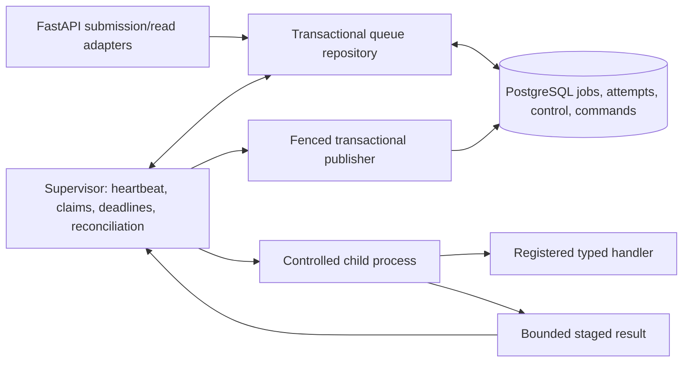

# PantryPulse — Worker and Job Queue Build Specification

**Version:** 0.1 · **Date:** October 24, 2026, America/New_York

**Parent authority:** [Project specification V5](SPEC-V5.md), especially sections 12–13, V5-A07/A12/A13 and OPEN-29–36.

**Inspected baseline:** main at `ca5909b`; only process health and bounded helpers are implemented. No worker, durable queue, job migrations or public job endpoints exist at this baseline.

**Purpose:** self-contained build context for the worker/queue foundation. Preserve V5's accepted requirements, supply concrete technical proposals, define interfaces and failure behavior, and identify the gates before public/domain integration.

**Design status:** implementation proposal. Requirements labeled **V5 REQUIRED** are already accepted. Details labeled **WQ PROPOSAL** are specified here for review and bounded implementation; they are not additional previously accepted BD decisions. This document does not amend V5 or mark OPEN-30/33/35 complete. Public schemas, authentication, domain publication and operational deployment retain their gates.

**Implementation follow-up:** PR #52 implements WQ-01–06 with fixed test handlers. [ADR 0005](../architecture/0005-worker-job-queue.md) records foundation decisions and review corrections; [PP-31–36](tasks/PP-31.md) records verification, and the [worker runbook](../setup/WORKER-QUEUE.md) covers local setup and recovery. The baseline above is historical; WQ-07–10 and the public/deployment gates remain open.

## 1. Outcome and build boundary

Build a durable, PostgreSQL-backed queue and a supervisor that runs one expensive operation at a time outside the HTTP process. Demonstrate admission, execution, publication, cancellation, interruption and manual retry with fixed test handlers before connecting forecasting or allocation.

The first milestone must prove:

> A job is durably accepted, claimed once at a time, executed inside a controlled process boundary, and published only by its current authorized attempt. API restarts do not erase accepted work. Worker loss never causes an automatic recomputation or an unconfirmed release of the compute slot.

This milestone is infrastructure evidence. A test handler is not a real forecast, allocation, valid domain result or completed PantryPulse workflow.

### 1.1 Included

- Pure state-transition, admission, freshness and deadline policies.
- Jobs-only PostgreSQL records and migrations, command idempotency and transactional capacity enforcement.
- Supervisor ownership/heartbeat, atomic claims, process containment, deadlines and cleanup.
- Fenced result publication, worker-loss reconciliation and manual retry against unchanged inputs.
- Internal handler/publisher interfaces, safe diagnostics and contract examples.
- Isolated PostgreSQL concurrency tests and controlled child-process tests.

### 1.2 Separate integration gates

- Presenter sessions, CSRF, proxy credentials and public access: OPEN-31.
- Public route/error/type generation review: OPEN-29/36.
- Actual forecast inputs, semantic forecast deduplication and publication: OPEN-12–18.
- Operational scenarios, inventory and solver contracts: OPEN-19–25.
- Comparison partial-result publication: OPEN-30 and the domain publisher contract.
- Demo reset, deletion and retention: OPEN-32.
- Live model qualification, effective container resources and deployment: OPEN-15/35 plus the existing setup pause.

Do not build stock mutations, research objectives, a second backend, arbitrary task execution, supplier logic or a model download as part of this work package. Keep the existing health response unchanged. Do not merge another branch or modify another worktree as an implicit prerequisite.

## 2. Accepted requirements to preserve

These values and behaviors are **V5 REQUIRED**; this document does not reopen them.

| ID | Requirement | V5 basis |
|---|---|---|
| WQ-R01 | Persist forecast, allocation and comparison jobs; return 202 only after durable acceptance | BD-11 |
| WQ-R02 | At most one active expensive top-level operation across the queue | BD-34 |
| WQ-R03 | At most two waiting top-level operations; maximum wait 900 seconds | BD-35 |
| WQ-R04 | Whole forecast operation at most 300 seconds | BD-35 |
| WQ-R05 | With fallback allowed, stop the primary by 270 seconds; fallback/cleanup/validation/publication share the original deadline | BD-38 |
| WQ-R06 | Native solver search 15 seconds per method; whole method 25 seconds; whole paired comparison 60 seconds | BD-35 |
| WQ-R07 | A comparison is one top-level operation; methods run sequentially on identical frozen operational inputs and equivalent settings | BD-34 |
| WQ-R08 | Supervisor heartbeat every 5 seconds; unavailable after 15 seconds without an update | BD-37 |
| WQ-R09 | Unavailable compute promptly rejects new computation with structured 503; saved reads and existing queued records remain | BD-31 |
| WQ-R10 | Lost running workers produce explicit interruption/failure; retry is manual with linked attempts and saved inputs | BD-12 |
| WQ-R11 | Stop actual computation on timeout/cancellation; canceling a future or changing a row is insufficient | V5 section 13 |
| WQ-R12 | Configurable compute-worker ceilings: 6 CPU equivalents and 8 GiB RAM; these do not include API/database needs | BD-36 |
| WQ-R13 | Keep reads/polling responsive; do not infer, solve, download/load models or create jobs in GET/probes/startup | V5 sections 4/12/13 |
| WQ-R14 | Backend presenter authorization for mutations/submissions; thin Next.js proxy does not replace it | BD-13/14 |
| WQ-R15 | Correlated redacted JSON logs and durable job/audit records; tracing deferred | BD-30 |
| WQ-R16 | Validate and commit results before planning-ready publication; preserve actual provider/native solver status and independent method failures | V5 sections 6/10/12 |

Fallback is not job retry. A native solver status is not a job lifecycle state. A heartbeat is not model qualification. A completed operation does not automatically mean a feasible plan.

## 3. Proposed architecture

**WQ PROPOSAL:** use PostgreSQL 16, the existing SQLAlchemy/psycopg/Alembic stack, one supervisor and a controlled child execution boundary. Introduce no broker dependency in the first implementation.



The API does not launch work in FastAPI background tasks or own an in-memory queue. The child does not control admission, heartbeat, job state, retry or final database publication. The supervisor remains responsive while the child computes.

Use short transactions. Never retain a queue database lock or transaction throughout inference, solving, waiting for a child, shutdown grace or network/model I/O. A process-local lock is not the durable concurrency authority.

Initial execution is single-host. Multiple supervisors may contend during startup/restart, but only one may own the lane; this is not a distributed worker fleet. Cross-host takeover and horizontal scaling require a later contract.

## 4. Terminology and invariants

| Term | Meaning |
|---|---|
| Lane | The single global expensive-computation capacity domain, initially `default` |
| Job | One immutable requested operation and input package; stable identity across manual attempts |
| Attempt | One queued/executing try with its own enqueue time, ownership, deadlines and outcome |
| Supervisor | Control-plane process maintaining heartbeat, ownership, containment and publication |
| Execution boundary | The owned child and any descendants/resources that must stop together |
| Fence | Current supervisor generation and attempt token checked before publication |
| Staged result | Validated transport output not yet published as a committed application result |
| Domain publisher | Handler-specific validation and transactional persistence of an outcome |

Required invariants:

1. At most one active attempt occupies the lane, including startup, validation/publication and unresolved cleanup.
2. At most two current attempts have state QUEUED. Limits are global, not two waiters per job type or organization.
3. One job has at most one current nonterminal attempt.
4. Retry never mutates the job's frozen input or prior attempt history.
5. No child can publish merely because it possesses an old job ID.
6. Releasing a database claim does not prove that old computation stopped.
7. A stale heartbeat revokes availability; it does not by itself free the active slot.
8. Queued work survives API/supervisor restarts, subject to its original queue deadline.
9. No completed result is overwritten by a late child, stale attempt or read request.
10. A test result is never exposed as a real forecast, allocation or verified research output.

## 5. Proposed state machines

The following enums are **WQ PROPOSAL** internal contracts, not existing public V5 enums. Keep database/application definitions aligned and reject unknown values.

### 5.1 Attempt states

| State | Meaning | Lane occupied? |
|---|---|---|
| QUEUED | Durably accepted and waiting; child not started | No |
| RUNNING | Claimed and executing or validating/publishing within its budget | Yes |
| STOPPING | Stop requested or publication revoked; cleanup not yet confirmed | Yes |
| SUCCEEDED | Typed operation outcome committed and acknowledged | No, after cleanup confirmation |
| FAILED | Classified execution/validation/publication failure with confirmed cleanup | No |
| TIMED_OUT | Applicable execution deadline exceeded; cleanup confirmed | No |
| INTERRUPTED | Worker lost or immediate shutdown interrupted running work; cleanup confirmed | No |
| CANCELLED | Explicit cancellation completed; no successful publication won the race | No |
| EXPIRED | Queue deadline reached before claim | No |

Terminal states are SUCCEEDED, FAILED, TIMED_OUT, INTERRUPTED, CANCELLED and EXPIRED. Do not infer native solver status from any of them.

Allowed transitions:

```text
QUEUED  -> RUNNING | CANCELLED | EXPIRED | FAILED
RUNNING -> SUCCEEDED | FAILED | STOPPING
STOPPING -> FAILED | TIMED_OUT | INTERRUPTED | CANCELLED
terminal attempt -> no further transition
```

QUEUED → FAILED is limited to an input-identity/integrity error or a contract that the deployed registry cannot execute, discovered before any child starts. Record its precise reason and that no execution boundary was created. It is not a substitute for ordinary queue expiry or cancellation. RUNNING → FAILED directly is allowed only if the child/boundary has already exited and cleanup is confirmed. Otherwise enter STOPPING. Revocation prevents publication immediately, even while cleanup is pending. Failure to confirm cleanup keeps the lane occupied and quarantined; do not fabricate a terminal cleanup success.

SUCCEEDED means execution produced and committed the publisher's valid operation outcome. For example, a native INFEASIBLE result may be a successfully executed solver operation without any candidate vector. A domain exception or invalid vector must not become SUCCEEDED. The domain adapter defines and tests this distinction before integration.

### 5.2 Job state and manual retry

Job state reflects its current/latest attempt; keep all prior attempts immutable. A manual retry creates attempt `n+1`, makes it current, and puts the job back in QUEUED. It does not rewrite attempt `n`.

**WQ PROPOSAL:** permit manual retry from FAILED, TIMED_OUT, INTERRUPTED, EXPIRED or CANCELLED after cleanup is confirmed. Reject retry while active/queued. A successful job is not retried: explicit recomputation is a new job with a new submission key. Reuse/deduplication of equivalent forecasts is a separate domain policy.

Every retry reuses the exact input hash/package. A user changing inputs submits a new job/scenario. A retry receives a new queue deadline and new execution budget; the older attempt's deadline is never extended or resumed.

### 5.3 Supervisor states

Proposed states: OFFLINE, STARTING, READY, DRAINING, RECOVERING and QUARANTINED. Busy is derived from an active attempt and is not unavailability.

Admission requires READY, a fresh heartbeat, valid runtime capabilities and no unresolved recovery/quarantine. An empty/stale/startup heartbeat cannot admit work. A healthy READY supervisor with an active attempt can accept waiters within capacity.

Compute availability and provider qualification remain separate. An unqualified Chronos adapter must not make an otherwise healthy baseline/test worker globally unavailable; the registered domain handler decides whether its requested provider/fallback combination is executable.

## 6. Persistence contract

**WQ PROPOSAL:** create jobs-only migrations first. Do not create speculative inventory/forecast/policy tables. The names below are proposed physical names. Use UTC `TIMESTAMPTZ`, UUID identifiers, constrained states, parameterized statements and explicit indexes.

### 6.1 `compute_control` — one seeded row per lane

| Field | Type / rule |
|---|---|
| `lane_id` | TEXT primary key; initial row `default` created by migration |
| `supervisor_id` | UUID nullable; fresh identity each supervisor startup |
| `generation` | BIGINT nonnegative, monotonically increased on ownership changes; never wrap |
| `host_identity` | TEXT nullable; identifies the local execution host/boot boundary |
| `state` | Constrained supervisor state |
| `heartbeat_at` | TIMESTAMPTZ nullable; written using database time |
| `active_attempt_id` | UUID nullable, unique active reference |
| `recovery_required` | BOOLEAN NOT NULL DEFAULT false |
| `effective_limits` | Validated versioned JSONB; configured/effective resource and deadline settings, no secrets |
| `updated_at` | TIMESTAMPTZ NOT NULL |

Lock this row for admission, claim, cancellation/retry and final publication/slot release. Heartbeat updates are short conditional writes by current supervisor/generation. A late heartbeat from an old generation must affect zero rows.

### 6.2 `compute_jobs`

| Field | Type / rule |
|---|---|
| `job_id` | UUID primary key |
| `lane_id` | TEXT NOT NULL, FK to `compute_control`; initially `default` |
| `organization_id` | UUID NOT NULL; trusted internal scope until actual ownership/auth adapters exist |
| `requested_by_ref` | TEXT NOT NULL; opaque trusted actor reference, not an email/name or chosen session format |
| `operation_kind` | FORECAST, ALLOCATION or COMPARISON |
| `handler_contract` | TEXT NOT NULL; exact registered/versioned input contract |
| `input_schema_version` | TEXT NOT NULL |
| `input_package` | JSONB NOT NULL; validated typed envelope, immutable after submission |
| `input_sha256` | 64 lowercase hex characters; hash of canonical validated input package |
| `current_attempt_id` | UUID nullable only during the atomic creation transaction |
| `state` | Constrained attempt-state projection |
| `created_at`, `updated_at` | TIMESTAMPTZ NOT NULL |

Organization IDs do not prove ownership by themselves. The core's trusted scope boundary must be documented; public submission waits for actual backend authorization and reference validation. Add organization foreign keys only once the owning schema is agreed, without weakening application scoping.

### 6.3 `compute_attempts`

| Field group | Required fields / rules |
|---|---|
| Identity | UUID `attempt_id`, job FK, positive `attempt_number`, unique `(job_id, attempt_number)` |
| Scope | `lane_id TEXT NOT NULL`, `organization_id UUID NOT NULL`; constrain both to the parent job through a matching composite FK/unique key |
| Queue | `enqueued_at`, `queue_deadline_at`; deadline = enqueue + 900 seconds under selected runtime profile |
| State | constrained state, safe reason code, `state_version` BIGINT for conditional transitions |
| Ownership | nullable supervisor UUID/generation and unpredictable UUID `execution_token` assigned at claim |
| Execution | `started_at`, immutable `execution_deadline_at`, optional `primary_deadline_at`, current phase |
| Containment | validated execution-boundary identity including host/start identity; bare PID is insufficient |
| Stop | `stop_requested_at`, reason, `cleanup_confirmed_at`, safe exit/termination diagnostics |
| Outcome | `completed_at`, result manifest/reference, safe structured error; no success manifest on failed attempts |

Use unique current-active ownership and repository checks to prevent two current nonterminal attempts for one job. Cross-table invariants require the ordered locked transactions below; ordinary CHECK constraints alone cannot enforce them.

Indexes: attempts on `(lane_id, state, enqueued_at, attempt_id)`; job/attempt organization lookup; attempts by job; nonterminal recovery lookup. Add partial unique indexes for one RUNNING/STOPPING attempt per lane and one QUEUED/RUNNING/STOPPING attempt per job. These are additional integrity guards, not a replacement for transactional admission and its two-waiter bound. Use scoped/composite references for current-attempt and active-attempt links so an attempt cannot belong to the wrong job/lane; handle circular references deliberately during migration and atomic creation.

### 6.4 `compute_commands` — request idempotency

Store command UUID, organization, action SUBMIT/RETRY/CANCEL, bounded opaque idempotency key, canonical request hash, job/attempt references and accepted response metadata. Unique `(organization_id, action, idempotency_key)`.

Same key plus same canonical request returns the existing accepted identity and consumes no additional capacity. Same key plus different request is a conflict. Rejected admission does not create a successful command record or consume the key. Record accepted command, job/attempt and audit event atomically.

This is command idempotency, not exactly-once execution or semantic forecast deduplication. Different submission keys may describe equivalent computations until the separate domain reuse contract is integrated.

### 6.5 Constraints and retention

Enforce valid state values, foreign keys, unique command/attempt identities, nonnegative generations, deadline ordering and required terminal outcome fields. Use guarded updates for immutable input/claim fields. Migration tests must exercise rejected invalid writes as well as valid rows.

Do not delete jobs, attempts, command records or published results automatically in this foundation. Reset and retention are OPEN-32. Dedicated integration tests may clean only their own isolated database/schema after verifying its identity.

## 7. Transactional admission and queue order

**WQ PROPOSAL:** serialize queue mutations with `SELECT ... FOR UPDATE` on the one `compute_control` lane row. Lock order is control → job → attempt → command/result records. Keep this order across submit/claim/cancel/retry/publication to avoid avoidable deadlocks. Normal reads acquire no mutation locks.

PostgreSQL row locking is the concurrency mechanism; a count followed by an unrelated insert is unsafe. `SKIP LOCKED` is not required for this single-lane design and alone would not enforce global capacity. [PostgreSQL locking reference](https://www.postgresql.org/docs/16/explicit-locking.html).

### 7.1 Submission transaction

1. Authenticate/authorize in the adapter; validate typed input and canonical request/hash before admission. Internal tests supply an explicit trusted actor/scope.
2. Begin transaction and lock lane row. Read live database time **after** the lock is acquired.
3. Resolve any matching idempotency command first. Existing accepted commands are readable even if compute is now unavailable; they do not represent new work.
4. Expire QUEUED attempts whose queue deadline has been reached. Update their job projection/audit in the same transaction.
5. Reject new work if the supervisor is not READY/fresh/capable or recovery is unresolved.
6. Count current QUEUED attempts in this global lane. If count is already two, reject with a distinct queue-full reason.
7. Insert immutable job, attempt 1 in QUEUED, command identity and audit record. Queue deadline is computed from this admission time.
8. Commit; only then return durable acceptance. On rollback, no accepted job/command exists.

No active slot is reserved by the API. With zero active and two queued attempts, a third submission can be rejected until the supervisor claims one; the ceiling does not promise three immediate admissions while idle. This avoids disguising an unclaimed third waiter as running.

Order queued attempts by `(enqueued_at ASC, attempt_id ASC)`. A retried old job gets a new enqueue time and goes to the tail. Initial priority is FIFO; no user-selected priorities or starvation-changing scheduling policy is introduced.

### 7.2 Claim transaction

1. Supervisor locks control and verifies its current identity/generation, READY state and no active/recovery boundary.
2. Expire overdue QUEUED attempts; select the oldest remaining current attempt and lock it.
3. Revalidate state, input identity, registered contract and queue deadline using current database time.
4. Set RUNNING, claim identity/token, started time, fixed execution deadlines and active-attempt reference atomically.
5. Commit before starting the child. Spawn failure becomes a recorded failed attempt with cleanup confirmation; it does not leave an immortal RUNNING row.

Execution time includes child startup, preparation, model work, validation and completion/publication work. The API/worker must never reset `started_at` after a slow load to manufacture more time.

### 7.3 Queue expiry

**WQ PROPOSAL boundary:** expiry applies at `database_now >= queue_deadline_at`. At 899.999 seconds the attempt may still be claimed; at 900 seconds it must expire. Preserve the terminal record and make manual retry deliberate.

Expiry scanning runs in supervisor control work and admission/recovery transactions. Saved GET requests do not silently mutate state. During total supervisor/database downtime, recording expiry can be delayed; the preserved deadline still prevents execution on recovery.

## 8. Ownership, heartbeat and crash recovery

### 8.1 Availability boundary

**WQ PROPOSAL boundary:** heartbeat is fresh only when `0 <= database_now - heartbeat_at < 15 seconds`. At exactly 15 seconds, treat it as unavailable. A future heartbeat/time anomaly fails closed with diagnostics. Use database clock time consistently for persisted freshness/deadlines; `clock_timestamp()` changes during execution, unlike transaction-start `now()`. [PostgreSQL time reference](https://www.postgresql.org/docs/16/functions-datetime.html).

A supervisor writes a heartbeat at startup only after configuration/recovery checks, then at intervals of at most five seconds while READY, including during expensive work. Heartbeat and deadline monitoring cannot depend on completion of `join()`, a model call or a solver call. Use separate short database operations; the child owns no heartbeat connection.

### 8.2 Startup and ownership

Acquire lane ownership under the control lock. A healthy existing owner causes the second supervisor to exit without changing ownership or executing work. Every new ownership grant increments generation and uses a fresh supervisor ID. Do not reuse a previous identity after restart.

Stale owner handling is a recovery operation, not ordinary claim stealing. Revoke/fence the old generation first, enter RECOVERING and refuse new admission/execution. Retain queued attempts/deadlines.

### 8.3 Lost worker and orphan safety

For an active attempt from a lost owner:

1. Revoke publication authority and mark STOPPING with interruption/recovery reason.
2. Identify its execution boundary using trusted host/runtime/start identity. Never kill a process based on a stored PID alone, a process name or a broad match.
3. Confirm the old execution boundary is gone, or terminate exactly that owned boundary and confirm cleanup.
4. Only then finalize INTERRUPTED and release the slot in a guarded transaction.
5. Require a manual retry; do not restart the handler automatically.

If identity/termination cannot be established, enter QUARANTINED and retain the active slot. Saved reads remain available; new work is unavailable. Administrative recovery must provide concrete containment evidence. Never release the slot just because fifteen seconds passed: the previous child could still be computing.

API restart is different from worker loss. Committed jobs/commands/results remain in PostgreSQL. A supervisor that retained valid ownership continues; an API restart must not duplicate submission or cancel it.

## 9. Controlled execution and time budgets

### 9.1 Process boundary

The initial production target is the existing Linux/container runtime on the affected Windows host. **WQ PROPOSAL:** one fresh controlled child boundary per attempt, with sequential child phases where needed. Keep the supervisor outside the child's computation/termination boundary. Model-resident pooling is a later measured optimization.

The process driver must implement `start`, nonblocking `poll`, `request_stop`, `force_stop` and `confirm_empty`. It must cover descendants, reap exited children and dispose of per-attempt transport resources. A generic Python `terminate()` does not stop descendants and can damage shared queues/locks; do not reuse corrupted IPC after a forced stop. [Python process-control reference](https://docs.python.org/3.12/library/multiprocessing.html#multiprocessing.Process.terminate).

The selected Linux containment implementation must prove orphan cleanup across supervisor death. A process-group/parent-death/container strategy needs specific tests; naming an abstraction is not proof. Native Windows support needs a separately tested equivalent. If a required runtime capability is absent, report it and do not advertise production compute as ready. No platform can be declared qualified merely because a stop signal was sent: cleanup confirmation is still required, and a missed deadline remains failed acceptance.

Handlers cannot request arbitrary shell commands, Python import paths, pickles or executable code from a job payload. Use a fixed registry of typed handler contracts. Test handlers are injected only in tests against the isolated database, and their outputs remain labeled test infrastructure artifacts.

### 9.2 Deadline calculation

Persist absolute deadlines at claim and use monotonic elapsed time locally. Use the smaller remaining allowance if database wall time and monotonic accounting disagree. A restart never resumes a running attempt with a fresh budget. A caller may request a smaller limit under the validated contract, never silently exceed the selected configured ceiling.

The child receives remaining budget and immutable identity, not permission to reset it. Supervisor monitoring and cleanup must start early enough to meet the actual cutoff. Reserve publication/cleanup allowance within the existing budget; do not add it afterward.

### 9.3 Forecast phases

| Phase | Required behavior |
|---|---|
| Prepare/load/primary | One attempt clock; all required series share it. No separate 300 seconds per series |
| Primary cutoff with fallback | Primary execution boundary must be stopped by attempt start + 270 seconds |
| Fallback | Starts earlier on a classified early failure, or after confirmed primary termination; uses remaining original budget |
| Validate/publish | Must fit within attempt start + 300 seconds; late raw output is not automatically publishable |

**WQ PROPOSAL:** use a configurable, positive shutdown grace contained within the budget; initial test profile two seconds. To meet the required primary cutoff, signal no later than 268 and force-stop by 270 if needed, accounting for measured scheduling/termination latency. Stop earlier where measured cleanup requires it. Confirm actual exit before fallback; if actual termination misses the cutoff, record the breach rather than claiming a guarantee from the signal time. This grace is an engineering proposal, not an additional BD value.

No baseline child overlaps the primary child. Keep the top-level slot throughout the phase change. If primary cleanup is unconfirmed, do not launch fallback. Provider/data sufficiency and allowed fallback remain handler policy; the supervisor does not convert arbitrary exceptions into baseline success.

The scheduler supports the budget; it does not prove the current synchronous forecasting branch can enforce partial/provider deadlines internally. A real adapter must expose a phase-aware boundary or split primary/fallback execution while preserving input/outcome semantics.

### 9.4 Allocation and comparison phases

- A standalone method has at most 25 seconds wall time, with at most 15 seconds native solver search inside it.
- A comparison has one 60-second parent deadline and runs CLASSICAL_GP then EGP_PI_INSPIRED sequentially, each with equivalent configured search/method limits and shared frozen operational identity.
- Per-method clocks begin at method construction/start, not after solving. Parent preparation/publication also consumes the parent budget.
- No method starts if its permitted remaining parent budget is exhausted. Record NOT_RUN with its reason; do not fabricate a native status or zero vector.
- Candidate access still passes through the existing status gate and an independent verifier.

Exact domain partial-comparison publication remains an integration gate. The worker core must carry separate method outcomes and never combine them into a fabricated successful plan. The foundation can test both-result transport/rollback with fixtures without selecting public partial-result behavior.

### 9.5 Resource envelope

Apply the configured 6-CPU-equivalent/8-GiB worker ceilings at a verified execution boundary. These are ceilings, not reserved capacity; record effective values. If parent and child share a capped container, its aggregate use must stay inside the cap and the supervisor must still meet heartbeat behavior. API/database need their own headroom.

Thread and library settings must be deliberate and recorded; do not equate CPU quota with thread count. No actual model install, heavy image build or benchmark is authorized by this document. Unit fixtures do not establish production resource enforcement.

## 10. Fenced validation and publication

The child returns bounded structured output to the supervisor. The core cannot accept an arbitrary filesystem path, SQL statement, executable callback name or object pickle as a result.

Suggested internal interfaces:

```text
Handler.validate_input(envelope) -> immutable typed input
Handler.execute(input, execution_context) -> typed staged outcome
Publisher.validate(input, staged_outcome) -> validated publication package
Publisher.publish(transaction, job, attempt, package) -> result manifest
```

The registry supplies actual implementations; payloads select only an allowed contract/version. Every registration must supply positive input/output serialized-size bounds, with safe overflow errors and no silent truncation. No production default is inferred. WQ-01–06 tests provide explicit small fixture bounds; real limits must be reviewed against actual forecast/snapshot sizes before enabling a domain handler.

Publication transaction:

1. Confirm the child is exited and cleanup is verified; keep the slot until completion.
2. Lock control → job → attempt in order.
3. Require current job attempt, RUNNING state, matching supervisor/generation/token, no stop/revocation and time remaining.
4. Revalidate immutable input identity and the handler/publisher's complete output contract.
5. Persist domain result rows/manifest and the attempt/job success/audit update atomically. Domain publisher failure rolls back all of them.
6. Clear the active slot only after cleanup is confirmed and successful publication is committed, or an explicit cleaned-up failure is committed.

A stale child/generation must affect zero publication rows and expose no new planning-ready result. Exact transaction ownership is with the repository; domain publishers must not open/commit independent nested sessions that break atomicity.

Bound database lock/statement waits by remaining publication time. Check live database time before the final guarded write. A network failure during COMMIT creates an **uncertain outcome**, not proof of rollback. Retain/quarantine ownership as appropriate; reconcile by exact job/attempt/command identity when the database is available, without rerunning computation or blindly writing another result. Do not assert perfect wall-time guarantees across an unacknowledged database commit.

A recovered committed result may be reported as committed after reconciliation; preserve its recorded execution/commit evidence and uncertainty history. An absent result is not manufactured from an expired child. Tests must cover both sides of this uncertainty.

## 11. Cancellation and shutdown

### 11.1 Cancel queued work

Under the control/job/attempt lock order, transition QUEUED to CANCELLED and record the command/audit. The worker must no longer claim it. Repeat identical cancellation commands return the accepted outcome. Queue expiry and cancellation races have one transactionally recorded winner.

### 11.2 Cancel running work

Transition RUNNING to STOPPING, revoke publication, signal the exact execution boundary, enforce its stop deadline and confirm cleanup before terminal CANCELLED/slot release. Return cancellation-requested state until cleanup finishes; do not promise it is stopped merely because a request returned.

Publication and cancellation serialize through the same locks. If publication already committed, cancellation reports an already-terminal conflict and does not remove results. If cancellation/revocation committed first, later publication fails its fence.

### 11.3 Supervisor shutdown modes

**WQ PROPOSAL:**

- **Drain:** mark DRAINING, reject new admission, retain queued work and finish only the active operation within its existing deadlines. Then exit without starting another queued job.
- **Immediate controlled stop:** mark DRAINING, revoke/stop active computation, confirm cleanup, finalize INTERRUPTED and retain queued work. No automatic retry on next startup.
- **Crash:** recovery follows section 8; it cannot assume graceful shutdown ran.

Do not use broad process kills or delete database/queue volumes as shutdown. Test commands must affect only their own named worker/runtime. Retention/reset is outside this build slice.

## 12. API proposal and security boundary

These are **WQ PROPOSAL** examples for OPEN-29 review, not existing routes or permission to expose unauthenticated submissions.

| Route | Proposed behavior |
|---|---|
| `GET /api/v1/jobs/{job_id}` | Scoped saved job/current attempt and prior-attempt summaries; no compute |
| `POST /api/v1/jobs/{job_id}/retry` | Presenter-only manual retry, fresh idempotency key; exact saved input |
| `POST /api/v1/jobs/{job_id}/cancel` | Presenter-only cancellation; requested versus completed state explicit |
| Domain submission routes | Validate domain input/auth, then call internal queue repository; 202 after commit |
| Readiness/capability route | Cheap core DB/schema and compute availability/capability metadata; exact path reviewed separately |

Do not add a generic public endpoint that executes arbitrary task types/input. Domain submission routes own their typed contracts. Generated TypeScript follows finalized Pydantic/OpenAPI; it is not handwritten from this example.

Example durable acceptance, fields proposed:

```json
{
  "job_id": "00000000-0000-4000-8000-000000000001",
  "attempt_id": "00000000-0000-4000-8000-000000000002",
  "state": "QUEUED",
  "status_url": "/api/v1/jobs/00000000-0000-4000-8000-000000000001",
  "request_id": "example-request"
}
```

| Condition | Proposed HTTP / error code | Meaning |
|---|---|---|
| Accepted command | 202 | Durable acceptance, not completed computation |
| Unknown or inaccessible saved resource | Final scoped 404 policy | Do not disclose another scope's job |
| Invalid request/domain input | 422 | No accepted job |
| Idempotency key reused with different input | 409 / `IDEMPOTENCY_CONFLICT` | Existing command unchanged |
| Retry/cancel invalid current state | 409 / `JOB_STATE_CONFLICT` | No new attempt/mutation |
| Compute not READY/fresh/capable | 503 / `COMPUTE_UNAVAILABLE` | Distinct from healthy busy |
| Two waiting attempts already present | 503 / `COMPUTE_QUEUE_FULL` | Capacity rejection, not a per-user rate-limit claim |
| Transient queue transaction unavailable | 503 / `QUEUE_STORAGE_UNAVAILABLE` | No false durable acceptance |

Keep `{error:{code,message,details},request_id}`. Queue expiry is a persisted job outcome, not retroactively a failed HTTP submission. Do not expose ownership tokens, full input snapshots, connection strings or unsafe tracebacks through status responses.

Presenter identity/organization comes from a trusted backend adapter, never a client-controlled role flag. Login/session/CSRF/proxy details remain OPEN-31; build internal tests before public mutation routes. A heartbeat may be shown as compute availability but not as Chronos/model readiness.

## 13. Logs, audit and read models

Record accepted command, state transition, claim, supervisor ownership change, stop/termination, manual retry, expiry, publication/reconciliation and relevant errors. Audit writes that establish a state transition belong to its transaction.

Safe structured context: request/job/attempt IDs, operation/phase, supervisor/generation, state transition, safe reason code, input hash, queue/execution duration, configured/effective limits and result references. Keep execution tokens out of public output and routine logs. Log identifiers/counts rather than raw input/result payloads.

Status reads expose current state, outcome/reason, queue and execution timestamps/deadlines, attempt number/history, cancellation progress, result references and safe provider/method metadata when committed. They do not load models, reconcile jobs as a side effect, start work or mutate snapshots.

The API/database can be healthy while compute is unavailable. Saved reads remain useful in that condition. If the database itself is down, do not promise successful saved reads or fabricate queue state from stale process memory.

## 14. Implementation packages and readiness

Suggested write boundaries are proposals to be checked against active work before implementation. This documentation task creates none of these modules.

| Package | Deliverable | Can start? |
|---|---|---|
| WQ-01 | Pure internal enums, transition/admission/freshness/deadline policies; input/context interfaces; independent expected tests | Yes, bounded proposal implementation; no domain/public policy implied |
| WQ-02 | Jobs/control/attempt/command migration and queue repository; transaction/idempotency/concurrency tests | After this technical schema/ownership proposal is reviewed; no need to finish inventory schema |
| WQ-03 | Supervisor ownership/heartbeat/claim loop and recovery against repository interface | Yes against explicit fakes; durable claims require WQ-02 |
| WQ-04 | Process driver, exact owned-boundary cleanup, deadline/cancellation tests | Yes with fixed non-ML test handlers; production Linux containment needs actual evidence |
| WQ-05 | Fenced transactional fixture publisher, rollback and commit-uncertainty reconciliation | After WQ-02; before real handler publication |
| WQ-06 | Complete isolated PostgreSQL + supervisor + fixed test-job vertical slice | After WQ-02–05; no actual forecasting/solver/model claims |
| WQ-07 | Forecast handler and fallback-phase adapter using reviewed forecasting core | After branch/input/provider/publication decisions; no automatic branch merge |
| WQ-08 | Allocation/comparison handlers and independent checked domain publishers | After mathematical/feasibility and partial-comparison gates |
| WQ-09 | Presenter-authorized proxy/API/status/retry/cancel and generated types | After OPEN-29/31 review and meaningful security tests |
| WQ-10 | Verified effective runtime limits, readiness/log schemas, operational rehearsal | Later authorized runtime work; preserve hosting/model pause |

Suggested modules:

```text
apps/api/app/services/jobs/
  contracts.py       # internal typed job/attempt/context records
  policies.py        # pure transition, admission, freshness, deadlines
  registry.py        # allowlisted typed handlers/publishers
apps/api/app/repositories/jobs.py
apps/api/app/models/jobs.py
apps/api/app/workers/
  supervisor.py
  process_driver.py
  recovery.py
  publication.py
apps/api/tests/jobs/
apps/api/tests/integration/test_job_queue.py
apps/api/tests/workers/
apps/api/migrations/  # jobs-only revisions after schema review
```

Public router/schema names and final migration organization follow shared review. Keep existing dependency locks unless a concrete need is reviewed. Do not use SQLite or an in-memory list as evidence of PostgreSQL durability/concurrency.

## 15. Acceptance tests

All cases below are requirements for this proposed build contract, not claims that tests already exist. Use injected clocks for pure boundaries; use real processes and real isolated PostgreSQL where the claim needs them. Short test budgets may replace production durations explicitly, while separate policy tests assert all accepted production values.

| Test ID | Required independent assertion |
|---|---|
| WQ-T01 | Every allowed/forbidden state transition; terminal attempts immutable; retry creates a new attempt |
| WQ-T02 | Pure admission recognizes global one-active/two-waiting and distinguishes busy, unavailable and full |
| WQ-T03 | Queue boundary 899.999/900 seconds; heartbeat 14.999/15/15.001 seconds; future-time anomaly fails closed |
| WQ-T04 | Whole-operation deadlines cannot be reset by child startup, phases, series or retrying a provider |
| WQ-T05 | Concurrent submissions under different keys never create a third QUEUED attempt or two active attempts |
| WQ-T06 | Concurrent identical key/payload creates one command/job/attempt; changed payload under same key conflicts |
| WQ-T07 | Failed/rolled-back acceptance creates no accepted command; accepted-response retry works after API crash/response loss |
| WQ-T08 | Two supervisors contend; only one fresh owner claims; old-generation heartbeats/publications affect zero rows |
| WQ-T09 | FIFO including equal enqueue-time UUID tie and manual retry at queue tail |
| WQ-T10 | Queued records survive restart; expired work never starts even after prolonged downtime |
| WQ-T11 | Heartbeat/status remain responsive during a busy controlled child |
| WQ-T12 | Actual child and descendant stop/cleanup verified; no slot release or fallback while orphan status is uncertain |
| WQ-T13 | Worker loss fences publication, confirms cleanup, records INTERRUPTED, retains other queued work and never recomputes automatically |
| WQ-T14 | Unverifiable PID/start/runtime identity quarantines; unrelated processes are untouched |
| WQ-T15 | Primary is actually stopped by 270 within a 300-second forecast policy; fallback shares the same budget |
| WQ-T16 | Early classified primary failure can start fallback early; invalid application input/programming error is not hidden |
| WQ-T17 | Both comparison methods sequential, same input identity/settings; 15/25/60 limits and NOT_RUN reason preserved |
| WQ-T18 | Invalid native status/vector cannot publish; valid operation INFEASIBLE is not fabricated into a feasible plan |
| WQ-T19 | Publisher failure rolls back result/job-success/audit/slot transition together |
| WQ-T20 | COMMIT response loss reconciles committed versus rolled-back outcomes by identity without duplicate execution/publication |
| WQ-T21 | Queued cancel versus claim/expiry and running cancel versus publication races have one guarded winner |
| WQ-T22 | Drain/immediate/crash shutdown each retains queued records and has correct active-attempt behavior |
| WQ-T23 | Unknown handler/code/import path rejected; oversized transport rejected without truncating into success |
| WQ-T24 | GET/probes start no work, change no job state and import/download no model |
| WQ-T25 | Public scope/auth/CSRF tests once adapters exist; no client-controlled presenter flag |
| WQ-T26 | Logs/status omit secrets, tokens, raw payloads and unsafe tracebacks; durable audit correlates transitions |
| WQ-T27 | Jobs-only migration upgrade/integrity/downgrade tested on a verified isolated PostgreSQL target |
| WQ-T28 | Effective CPU/memory containment and supervisor responsiveness measured before production capability is advertised |

For concurrency tests, use barriers/independent database connections and assert committed rows, not only mocked call counts. For process tests, wait for concrete readiness signals and inspect exact owned execution boundaries. A sleeping fake provider tests timeout infrastructure, not model behavior.

## 16. First-milestone definition of done

The foundation is complete when WQ-01–06 pass their relevant tests and evidence shows:

1. A typed fixed test input is accepted and stored atomically.
2. One supervisor claims it and starts exactly one concurrent execution boundary.
3. Heartbeat and saved reads continue during execution.
4. Current-authority publication commits a test manifest atomically; stale authority cannot publish.
5. Simultaneous admission, queue expiry, cancellation, real process timeout and worker loss behave as specified.
6. Restart retains queued work and manual retry creates a linked attempt with unchanged input.
7. Uncertain cleanup/publication is explicit and fails closed; it never causes overlap or invented success.
8. The existing API health/helper tests still pass; no unrelated scope, locks or source data was altered.

Record commit, exact commands, runtime/config, isolated DB identity, test counts and remaining limitations. Do not label V5-A12 fully passed until real runtime/DB containment and the applicable integrated behavior are verified. Public API and domain handler completion remain separately reported.

## 17. Builder handoff instructions

Use this document with V5; do not infer accepted policy from old examples. Begin with WQ-01 and a short review of this document's technical proposals. Before durable code, freeze the jobs-only schema, lock order, current-attempt ownership, state vocabulary and uncertainty behavior in the build record. No broad product interview is needed to restate V5's already accepted ceilings.

For each package:

- Inspect the active checkout and preserve unrelated work. Record base SHA and exact write paths.
- Add meaningful independent failing cases, implement the bounded behavior, then run targeted checks.
- Keep pure tests, PostgreSQL integrity tests, process containment tests and real domain tests distinct.
- Report a missing dependency/runtime as NOT RUN, not success; do not weaken a gate or fabricate a fixture-backed feature.
- Do not expose public mutations until their presenter/proxy/security contract is implemented.
- Preserve paused Chronos/hosting and supplier work. Do not install models, start heavy builds, publish/deploy or merge another branch as an implicit part of worker development.

The expected output of this build is a reviewed worker foundation and its evidence, followed by separately gated handler/API integration. It is not a completed forecasting, solver or operational inventory system.

## 18. Proposal register and unresolved integration items

| ID | Technical proposal in this document | Review state |
|---|---|---|
| WQ-D01 | PostgreSQL single lane/control-row serialization, existing Python/DB stack | Proposed |
| WQ-D02 | Stable job + immutable attempts; internal states and manual-retry rules | Proposed |
| WQ-D03 | Global FIFO, at most two QUEUED, no API-reserved active slot | Proposed |
| WQ-D04 | 900-second expiry and 15-second staleness apply at equality | Proposed boundary clarification |
| WQ-D05 | Supervisor generation/attempt token fence; no automatic stale-owner execution takeover | Proposed |
| WQ-D06 | Cleanup confirmation before slot release; quarantine if orphan identity is uncertain | Proposed safety mechanism |
| WQ-D07 | Jobs-only schema and accepted-command idempotency | Proposed; domain FK/auth adapters gated |
| WQ-D08 | One controlled child boundary per attempt/phase; two-second initial stop grace inside existing deadline | Proposed; actual Linux driver proof required |
| WQ-D09 | Atomic publisher interface and explicit uncertain-COMMIT recovery | Proposed |
| WQ-D10 | Drain/immediate shutdown and no automatic retention deletion | Proposed |
| WQ-D11 | Candidate job read/retry/cancel routes and 503 queue-full code | Proposed public contract, not yet approved/exposed |

Before WQ-07–10, resolve handler-specific payload/result size bounds, final domain input/output schemas and numerical bridging, semantic forecast reuse, comparison partial publication, public authentication/routes/CSRF, retention/reset and effective process/container configuration. These do not prevent pure foundation work or a reviewed jobs-only vertical slice.

## 19. Source references

- [Project specification V5](SPEC-V5.md): accepted behavior, BD-11/12/13/14/30/31/34–38 and OPEN-29–36.
- [Backend specification](BACKEND-SPEC.md): durable execution, publication, access and implementation-gate history.
- [Migration boundary](../../apps/api/migrations/README.md) and [generated contracts boundary](../../packages/contracts/README.md): current repository limits.
- [PostgreSQL 16 locking](https://www.postgresql.org/docs/16/explicit-locking.html): transactional locking capabilities; the single-lane protocol here is a PantryPulse proposal.
- [PostgreSQL time functions](https://www.postgresql.org/docs/16/functions-datetime.html): live clock versus transaction-start timestamps.
- [Python 3.12 process termination](https://docs.python.org/3.12/library/multiprocessing.html#multiprocessing.Process.terminate): descendant/IPC limitations that the containment implementation must address.

This document is local build context. It does not change V5's accepted decisions, implement any worker code, publish public endpoints or update another document/chat.
