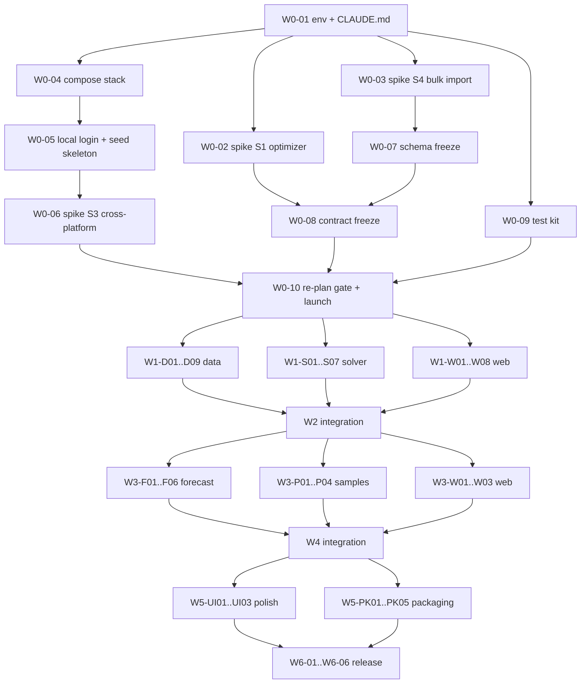

# PantryPulse v1 — Parallel Implementation Plan

> **For agentic workers:** REQUIRED SUB-SKILL: use superpowers:subagent-driven-development (in-session lanes) or superpowers:executing-plans (multi-session lanes) to implement your lane's tasks one by one. Steps use checkbox (`- [ ]`) syntax for tracking. Read [ORCHESTRATION.md](ORCHESTRATION.md) before starting any task.

**Goal:** Deliver [V1-SPEC](../../pantrypulse/V1-SPEC.md) (bring-your-own network, Pantry and Retail modes, one-command local install) through waves of at most three concurrent lanes, coordinated by one orchestrator session that reports to Gabriel.

**Architecture:** Wave 0 freezes the local stack, the DB schema and the v1 API contract. New routers are thin, lead-owned stubs that delegate to lane-owned service modules. Each lane fills in its own modules in its own git worktree without touching shared wiring. Integration waves merge lanes one at a time into `v1-local` with Gabriel's approval and run the full gates on the combined tree.

**Tech Stack:** FastAPI + Pydantic 2 + SQLAlchemy 2 + Alembic + PostgreSQL 16, OR-Tools CP-SAT 9.15, Next.js 16 / React 19 / Tailwind 4 / shadcn 4, Playwright + axe, Vitest (adopted in W0), Docker Compose.

**Spec:** [docs/pantrypulse/V1-SPEC.md](../../pantrypulse/V1-SPEC.md) (approved 2026-11-04). Gap evidence: [docs/GAP-REPORT.md](../../GAP-REPORT.md). Acceptance rows: [ACCEPTANCE-MATRIX.md](../../pantrypulse/ACCEPTANCE-MATRIX.md). SPEC-V5 governs everything V1-SPEC does not change.

**Base:** `v1-local` at `71cc435`. **Plan status:** waves 1–6 are written in full, but tasks marked **[conditional on S<n>]** are re-checked at the **re-plan gate** (W0-10) before wave 1 starts (Gabriel's decision, 2026-11-04).

## Global Constraints

Every task's requirements include these. The values are from V1-SPEC and CLAUDE.md.

- Start command `docker compose up` from the repo root. Only `web` is published, on `127.0.0.1:${PP_WEB_PORT:-3000}`. Postgres and the API are not published. Docker is the only runtime prerequisite.
- Supported OSes: Windows 11 (Docker Desktop, WSL 2) and Ubuntu 24.04. macOS is out of v1.
- No paid keys anywhere in the core journey. The only outbound calls are the labeled Census lookups and Google calls the user opted into with their own key. The Google key never reaches logs or the browser.
- Envelope: ≤ 100 locations, ≤ 500 products, ≤ 90 days daily history (≥ 14 to forecast, ≥ 35 to backtest), ≤ 200,000 batches, ≤ 50,000 series. Anything over it is rejected with the limit named, never truncated.
- Ceilings: 300 s search / 330 s method / 690 s comparison; forecast 270/300 s; worker 6 CPU / 8 GiB; queue expiry 1800 s.
- Preserved from V5:
  - hard FEFO;
  - usable through the expiry day, and unknown expiry is unavailable;
  - the BD-48 daily order (arrivals first);
  - explicit transfer mode, **no default**;
  - frozen hashed scenarios;
  - durable 202 jobs;
  - the same-origin Next.js proxy;
  - backend presenter auth and CSRF;
  - the independent verifier on every published result;
  - native solver statuses (FEASIBLE is never relabeled OPTIMAL).
- Null demand stays null. A donation `0` is distinct from missing. No future leakage. Different units are never summed into an unlabeled total. Per-action effects are never added up.
- Defaults (lead calls in the spec): road factor 1.3, 45 mph, k = 10 candidate senders within 150 miles, `w_exp = 1`, `w_lost = 1`, reserve floors 0, blank capacity = no limit, cost budget off, Chronos off by default.
- Exact copy:
  - "Sample data — fictional"
  - "sales (undercounts demand when shelves were empty)"
  - "capacity not provided — no limit assumed"
  - "no scheduled deliveries provided"
  - "accuracy not evaluated: needs 35+ days"
  - "on your last 4 weeks, this forecast was off by about X%"
  - "expected donations (forecast, not confirmed): X"
  - "effect of this action given the rest of the plan; effects don't add up across actions"
  - "simulated plan; no stock was reserved or moved"
  - the login line `Open http://127.0.0.1:3000 — username: local — password: see .pantrypulse/local-login.txt`
- EGP_PI_INSPIRED remains a bounded adaptation of Rampazo et al. (DOI 10.1111/itor.70252). Run `research-claims-check` on any copy that mentions it.
- The app never changes its own stock. Receipts, posting, adjustments and lot declarations are hidden from v1 navigation, and their API stays.

## Review Focus

These are the inputs V1-SPEC implies but doesn't name, most likely to bite a real user first. Each has a pinning test in its owning task.

1. **CSV files saved by Excel on Windows**, with a UTF-8 BOM, CRLF line endings, or a non-UTF-8 encoding. Expected: BOM and CRLF accepted, non-UTF-8 rejected with a reason, never a crash. Pinned by `test_utf8_bom_and_crlf_accepted` and `test_non_utf8_file_rejected_with_reason` (W1-D02).
2. **IDs with stray whitespace or different case** (`"P01 "` vs `"P01"`). Expected: cells are trimmed and IDs are case-sensitive, so duplicates after trimming are reported. Pinned by `test_duplicate_key` and `test_ids_case_sensitive_after_trim` (W1-D02).
3. **Non-ISO dates** (`11/04/2026`). Expected: rejected with "use YYYY-MM-DD", never guessed. Pinned by `test_non_iso_date_rejected` (W1-D02).
4. **Quantities beyond the solver's integer bounds** (e.g. 250,000 cases in one batch). Expected: a clear import error, not a 500 at scenario freeze. Pinned by `test_quantity_above_solver_bound_rejected` (W1-D02).
5. **A location or product with no usable history** (a new store, or all blank days). Expected: listed as not forecast-eligible, never forecast from zeros. Pinned by `test_location_with_all_blank_history_listed_not_forecast` and `test_series_under_14_days_listed_ineligible_not_zero_filled` (W3-F03).

## Files in this plan

| File | Purpose |
|---|---|
| [ORCHESTRATION.md](ORCHESTRATION.md) | Roles, execution modes, communication, escalation, reporting, merge policy |
| [wave-0.md](wave-0.md) | Foundation (orchestrator): spikes, local stack, schema, contract freeze, test kit |
| [wave-1.md](wave-1.md) | Lanes `w1-data`, `w1-solver`, `w1-web` |
| [wave-2.md](wave-2.md) | Integration of wave 1 (orchestrator) |
| [wave-3.md](wave-3.md) | Lanes `w3-forecast`, `w3-samples`, `w3-web` |
| [wave-4.md](wave-4.md) | Integration of wave 3 (orchestrator) |
| [wave-5.md](wave-5.md) | Lanes `w5-polish`, `w5-packaging` |
| [wave-6.md](wave-6.md) | Release and acceptance (orchestrator + Gabriel) |
| [prompts/](prompts/) | Ready-to-paste orchestrator prompt and one prompt per lane per wave |
| [status/](status/) | One status file per lane, written only on that lane's branch ([template](status/TEMPLATE.md)) |
| `spikes/` | Spike findings (S1, S3, S4 in W0; S5, S6 in W1; S7 in W3) |

## Why seven waves

V1-SPEC has four large domains (data/import, solver, forecast, web), plus sample networks that need the importer first. With a cap of 3 lanes, those domains take two build waves, and each build wave is followed by an integration wave. Web (~4 lane-days) and solver (the riskiest, spike 1) are the critical path, so both start in wave 1. Forecast is the smallest domain, so it moves to wave 3.

```mermaid
flowchart LR
  W0["W0 Foundation<br/>orchestrator<br/>spikes S1·S3·S4, stack, schema,<br/>contract freeze, test kit"]
  G0{{"Re-plan gate<br/>Gabriel approves"}}
  subgraph W1["W1 — 3 lanes (multi-session)"]
    D[w1-data]
    S[w1-solver]
    WB1[w1-web<br/>against mocks]
  end
  W2["W2 Integrate W1<br/>data → solver → web"]
  subgraph W3["W3 — 3 lanes (multi-session)"]
    F[w3-forecast]
    P[w3-samples]
    WB3[w3-web<br/>real API]
  end
  W4["W4 Integrate W3<br/>forecast → samples → web"]
  subgraph W5["W5 — 2 lanes (multi-session)"]
    PO[w5-polish]
    PK[w5-packaging]
  end
  W6["W6 Release & acceptance<br/>orchestrator + Gabriel"]
  W0 --> G0 --> W1 --> W2 --> W3 --> W4 --> W5 --> W6
```

## Task dependency graph

Arrows mean "must be merged before it can start". Tasks inside one lane run in ID order unless the wave file says otherwise.

Cross-lane needs inside a wave are met only through the frozen contract, never through another lane's unmerged code:

- **w3-web** wires to the wave-1 code already merged on `v1-local`. For the wave-3 forecast and samples endpoints it uses the contract examples until W4.
- **w1-data W1-D09** builds a scenario from a *fixture* forecast run. The forecast lane is not active until W3.

## Lead-only files (never edited by a lane)

`docs/pantrypulse/BOARD.md`, `CLAUDE.md`, `.claude/**`, `packages/contracts/**`, `apps/api/migrations/**`, `apps/api/app/models/**`, `apps/api/app/schemas/**`, `apps/api/app/routers/**`, `apps/api/app/main.py`, `apps/api/app/workers/production.py`, `apps/api/app/workers/registries.py`, `package.json`, `package-lock.json`, `apps/web/package.json`, `apps/web/vitest.config.mts`, `apps/api/pyproject.toml`, `apps/api/uv.lock`, `.github/**`, `compose.yaml`, `compose.dev.yaml`, `compose.compute.yaml`, `compose.forecast.yaml`, `compose.chronos.yaml`, `compose.demo.yaml`, `apps/api/Dockerfile*`, `apps/web/Dockerfile`, `.gitattributes`, `.gitignore`, `scripts/quality/**`, `docs/plans/v1/**` (except the lane's own `status/<lane>.md` and the spike files a task assigns), `docs/pantrypulse/V1-SPEC.md`, `docs/pantrypulse/ACCEPTANCE-MATRIX.md`, `apps/api/tests/integration/test_v1_*.py` (orchestrator's cross-lane journey tests).

## File-ownership matrix

Paths are relative to the repo root. `api/` = `apps/api/`, `web/` = `apps/web/`. Two lanes in the same wave never share a path. Anything not listed for a lane is outside its ownership. Needing such a file is an escalation ([ORCHESTRATION.md §5](ORCHESTRATION.md#5-escalation-stop-and-report)).

| Wave | Lane | Owns (create/modify) |
|---|---|---|
| W0 | orchestrator | everything needed for W0 tasks; spike code lives only on throwaway `spike/w0-*` branches |
| W1 | `w1-data` | `api/app/services/imports/**`, `api/app/services/enrichment/**`, `api/app/services/networks/**`, `api/app/repositories/networks.py`, `api/app/repositories/imports.py`, `api/app/repositories/enrichment.py`, `api/app/workers/imports.py`, `api/app/workers/enrichment.py`, `api/tests/imports/**`, `api/tests/enrichment/**`, `api/tests/networks/**`, `api/tests/fixtures/census/**`, `api/tests/fixtures/google/**`, `api/scripts/bench_import.py`, `data/templates/blank/**`, `docs/plans/v1/spikes/S5-census.md`, `docs/plans/v1/spikes/S6-google.md`, `docs/plans/v1/status/w1-data.md` |
| W1 | `w1-solver` | `api/app/services/optimization/**`, `api/app/workers/optimization.py`, `api/app/workers/allocation.py`, `api/tests/optimization/**`, `data/demo/or-v3/**`, `scripts/or/**`, `docs/optimization/evidence/v1-*`, `docs/plans/v1/status/w1-solver.md` |
| W1 | `w1-web` | `web/src/**` except `web/src/app/globals.css`, `web/tests/**`, `web/public/**`, `docs/plans/v1/status/w1-web.md` |
| W2 | orchestrator | merges; `api/tests/integration/test_v1_*.py`; fixes through `integration-fixer` within the failing lane's former paths |
| W3 | `w3-forecast` | `api/app/services/forecasting/**`, `api/app/services/inventory/**`, `api/app/services/danger/**`, `api/app/workers/forecasting.py`, `api/app/workers/chronos_forecasting.py`, `api/tests/forecasting/**`, `api/tests/danger/**`, `api/tests/test_inventory_projection.py`, `api/scripts/bench_forecast.py`, `docs/forecasting/evidence/v1-*`, `docs/plans/v1/spikes/S7-forecast-volume.md`, `docs/plans/v1/status/w3-forecast.md` |
| W3 | `w3-samples` | `api/app/services/samples/**`, `api/app/services/imports/templates.py` (the `example` branch only), `data/samples/**`, `data/templates/examples/**`, `api/tests/samples/**`, `api/scripts/generate_samples.py`, `docs/plans/v1/status/w3-samples.md` |
| W3 | `w3-web` | same paths as `w1-web`, plus `docs/plans/v1/status/w3-web.md` |
| W4 | orchestrator | merges; `api/tests/integration/test_v1_*.py`; `web/tests/e2e/v1-full-journey.spec.ts` (moves to `w5-polish` in W5); fixes via `integration-fixer` |
| W5 | `w5-polish` | `web/src/**` **including** `web/src/app/globals.css` (tokens), `web/tests/e2e/**`, `docs/pantrypulse/visual-evidence/**`, `docs/plans/v1/status/w5-polish.md` |
| W5 | `w5-packaging` | `README.md`, `INSTALLATION.md`, `docs/testing/**`, `scripts/testing/**`, `scripts/bench/**`, `compose.test.yaml`, `docs/pantrypulse/HARDWARE.md`, `docs/plans/v1/status/w5-packaging.md` |
| W6 | orchestrator | everything, with Gabriel's approval for release actions |

Ownership moves between waves, never within one. For example, `scripts/testing/story-coverage.cjs` is created by the orchestrator in W0-09 and owned by `w5-packaging` in W5.

## Isolation table

All lanes share the existing CI-style PostgreSQL container `pp-ci-postgres` (`127.0.0.1:55433`). Every test database name must end in `_test` (`apps/api/tests/integration/conftest.py:3`). Ports 8000, 8010, 55432 and 55433 are already taken on the dev machine.

| Lane | Worktree | Branch | API port | Web dev / Playwright port | Stack port (`PP_WEB_PORT`) | Test database | `COMPOSE_PROJECT_NAME` |
|---|---|---|---|---|---|---|---|
| orchestrator | `~/code/PantryPulse` | `v1-local`, `w0/foundation`, `w2/integration`, `w4/integration`, `w6/release` | 8004 | 3000 | 3000 | `pantrypulse_int_test` | `pantrypulse` |
| `w1-data` | `~/code/PantryPulse-data` | `lane/w1-data` | 8001 | 3001 | 3101 | `pantrypulse_data_test` | `pp-data` |
| `w1-solver` | `~/code/PantryPulse-solver` | `lane/w1-solver` | 8002 | 3002 | 3102 | `pantrypulse_solver_test` | `pp-solver` |
| `w1-web` | `~/code/PantryPulse-web` | `lane/w1-web` | 8003 | 3003 | 3103 | `pantrypulse_web_test` | `pp-web` |
| `w3-forecast` | `~/code/PantryPulse-forecast` | `lane/w3-forecast` | 8001 | 3001 | 3101 | `pantrypulse_forecast_test` | `pp-forecast` |
| `w3-samples` | `~/code/PantryPulse-samples` | `lane/w3-samples` | 8002 | 3002 | 3102 | `pantrypulse_samples_test` | `pp-samples` |
| `w3-web` | `~/code/PantryPulse-web` (recreated at the W3 base) | `lane/w3-web` | 8003 | 3003 | 3103 | `pantrypulse_web_test` | `pp-web` |
| `w5-polish` | `~/code/PantryPulse-polish` | `lane/w5-polish` | 8001 | 3001 | 3101 | `pantrypulse_polish_test` | `pp-polish` |
| `w5-packaging` | `~/code/PantryPulse-packaging` | `lane/w5-packaging` | 8002 | 3002 | 3102 | `pantrypulse_packaging_test` | `pp-packaging` |

**Untracked files copied into every worktree** by the orchestrator (with `cp`, never printed). These files are gitignored or excluded, so `git worktree add` does not bring them:

| File | Why |
|---|---|
| `apps/api/.env` | API settings for local runs |
| `apps/api/.env.demo` | connected demo settings |
| `apps/web/.env.local` | proxy origin and token (overridden per lane by `.env.lane`) |
| `.claude/settings.local.json` | local permission allowances |

**Generated per worktree:** `.env.lane` (gitignored by the existing `.env.*` rule). It contains `PP_API_PORT`, `PLAYWRIGHT_PORT`, `PANTRYPULSE_API_ORIGIN=http://127.0.0.1:<API port>`, `PP_WEB_PORT`, `COMPOSE_PROJECT_NAME`, `PP_TEST_DATABASE_URL` and `PP19_TEST_DATABASE_URL`. The URLs are built from the orchestrator's existing test URL with only the database name changed. Lanes load it with `set -a; . ./.env.lane; set +a`. Shell exports take precedence over `.env.local` in Next.js. `.env.lane` **never** holds `PP_PRESENTER_PASSWORD_HASH`: the `$` in the scrypt hash expands during shell loading, so every presenter login returns 401.

**Per-worktree setup:** `npm ci`, `uv sync --frozen --project apps/api`, `npx playwright install chromium`. The Stop hook runs the quick gate inside every lane session, so these must exist.

## Integration order and update policy

- **W2:** `w1-data` → `w1-solver` → `w1-web`. **W4:** `w3-forecast` → `w3-samples` → `w3-web`. **W6:** `w5-packaging` → `w5-polish`.
  - Backend lanes merge first, ordered by how many later lanes read their code.
  - Web always merges last, because it replaces mocks with the real API.
- **No rebasing of pushed branches.** The PreToolUse hook blocks `git push --force`/`-f`, including `--force-with-lease` (`.claude/hooks/pre-tool.cjs`). After each merge into `v1-local`, the next lane runs `git fetch && git merge origin/v1-local`, re-runs its focused tests and the quick gate, and pushes normally.
- Merges into `v1-local` use merge commits (`gh pr merge --merge`), and **only after Gabriel approves each one**.

## Interfaces frozen in W0-08

Lanes code against these names. W0-08 may adjust them before the freeze. If it does, it updates this table and every affected wave file and prompt at the re-plan gate. After the freeze, changing them takes a change request.

**Envelope constants** (`app/schemas/v1_envelope.py`, from V1-SPEC §5.1): `MAX_LOCATIONS = 100`, `MAX_PRODUCTS = 500`, `MAX_HISTORY_DAYS = 90`, `MIN_FORECAST_HISTORY_DAYS = 14`, `MIN_BACKTEST_HISTORY_DAYS = 35`, `MAX_BATCHES = 200_000`, `MAX_FORECAST_SERIES = 50_000`, `MAX_REPORTED_ERRORS = 1000`. [conditional on S1: may be lowered under V1-D15 step 2]

**Enums** (`app/schemas/v1_planning.py`):
- `NetworkMode = PANTRY | RETAIL`.
- `LocationRole = hub | pantry | distribution_center | store`.
- `AllocationMethod = NO_TRANSFERS | EQUAL_SHARE | MOST_URGENT_FIRST | CLASSICAL_GP | EGP_PI_INSPIRED | SOONEST_EXPIRY_FIRST | RETAIL_OPTIMIZED`.
  - Pantry uses the first five; Retail uses `NO_TRANSFERS`, `SOONEST_EXPIRY_FIRST`, `RETAIL_OPTIMIZED`.
- `Measure = UNITS | USD`.
- `RouteMethod = straight_line_estimate | google_road | routes_csv`.
- `ExplanationKind = proven_binding | inferred`.
- The existing `TransferMode` (`HUB_ONLY | HUB_AND_PANTRY`) is unchanged.

**HTTP routes** (prefix `/api/v1`). Mutating routes keep presenter session + CSRF, and long work returns 202 with a durable job. v1 forecasts and comparisons live under `/networks/{id}/…` so the v2 routes and models stay byte-identical (A22; Gabriel, 2026-11-06):

| Route | Response schema | Implemented by |
|---|---|---|
| `GET /networks`, `GET /networks/{network_id}` | `NetworkList`, `Network` | W1-D05 |
| `GET /templates`, `GET /templates/{name}.csv?kind=blank\|example` | `TemplateCatalog`, `text/csv` | W1-D03 (blank), W3-P03 (example) |
| `POST /imports` (`{network: {name, mode, timezone}}` or `{network_id}`) | 201 `ImportCreated{import_id, network_id}` (`network_id` null for a new network until its import succeeds; atomic import, `ppv1_0010`) | W1-D05 |
| `POST /imports/{import_id}/files/{name}` (raw `text/csv` body, streamed, 160 MiB cap; [decision](decisions/W0-08-scenario-and-import.md)) | `ImportFile{name, bytes, sha256}` | W1-D04 |
| `POST /imports/{import_id}/commit` (`{as_of_date?}`) | 202 `ImportAccepted{import_id, job_id}` | W1-D05 |
| `GET /imports/{import_id}` | `ImportStatus{phase, files[], progress{unit, done, total}, errors[RowError{file, line, column, code, reason, fix}], error_count, errors_truncated, outside_horizon_inbound[], dataset_version_id, failure{kind, message, reason, next_steps[]}}` | W1-D05 |
| `GET /networks/{id}/enrichment`, `POST /networks/{id}/enrichment/retry` | `EnrichmentStatus`, 202 | W1-D06 |
| `PUT /networks/{id}/locations/{location_id}/attributes` | `LocationAttributes` (manual override or `excluded=true`) | W1-D06 |
| `GET /networks/{id}/routes` | `RouteList` (each route carries `method`, `fetched_at`) | W1-D07/D08 |
| `GET /settings`, `PUT /settings/google-maps-key`, `DELETE /settings/google-maps-key` | `LocalSettings{google_maps_configured: bool}`; the key is write-only | W1-D08 |
| `POST /networks/{id}/routes/google-preview`, `POST /networks/{id}/routes/google-fetch` | `GoogleLookupPreview{lookups}`, 202 | W1-D08 |
| `POST /networks/{id}/scenarios` | `ScenarioV3` | W1-D09 |
| `POST /networks/{id}/forecasts`, `GET /forecasts/{job_id}/backtest` | `ForecastAccepted`, `BacktestResult` | W3-F02/F03 |
| `GET /networks/{id}/danger?forecast_run_id=` | `DangerRanking` | W3-F05 |
| `POST /networks/{id}/comparisons` (`scenario_id`, `methods[]`, `measure`), `GET /networks/{id}/comparisons/{comparison_id}` | `ForecastAccepted`, `SavedComparisonV3` (per-method result, verification, `usd_unavailable_reason`) | W1-S04 |
| `GET /networks/{id}/comparisons/{comparison_id}/methods/{method}/actions` | `DecisionActions{actions[DecisionAction], non_additive_label}` | W1-S06 |
| `POST /networks/{id}/comparisons/{comparison_id}/methods/{method}/export` (`action_ids[]`) | `text/csv` | W1-S07 |

**Job kinds** (registered in `workers/production.py` by W0-08, with handlers in lane-owned modules; until a lane builds one, its stub handler from `app/workers/v1_stub.py` answers admission with 501 and is never advertised for execution. `import.v1` uses the new `IMPORT` operation kind and `enrichment.v1`/`routes-google.v1` the new `ENRICHMENT` kind, each with a 300 s ceiling; migration `ppv1_0009`): `import.v1` (`app.workers.imports`), `enrichment.v1` and `routes-google.v1` (`app.workers.enrichment`), `forecast.v1` (existing; extended for networks and the backtest, `app.workers.forecasting`), `or-comparison.v3` (`app.workers.optimization`). The existing `or-comparison.v2` stays (A22).

**Service functions the routers call** (lane-owned; W0-08 creates each as a stub that raises `NotImplementedV1(task_id)`, `app.services.v1_errors.NotImplementedV1`, which maps to a 501 in the existing error envelope `{"error": {"code": "NOT_IMPLEMENTED", "message": "...", "details": {"task": "<task id>"}}, "request_id": "..."}`; Gabriel, 2026-11-06):

| Module | Signature | Task |
|---|---|---|
| `app.services.imports.validate` | `validate_files(files: Mapping[TemplateName, BinaryIO], settings: ImportSettings, envelope: Envelope = V1_ENVELOPE) -> ValidationReport` | W1-D02 |
| `app.services.imports.templates` | `template_catalog(mode: NetworkMode \| None) -> TemplateCatalog`; `template_csv(name: TemplateName, kind: Literal["blank", "example"]) -> str` | W1-D03, W3-P03 |
| `app.services.imports.api` | `create_import(rt, scope, request: ImportCreate) -> ImportCreated`; `store_import_file(rt, scope, import_id: UUID, name: TemplateName, chunks: AsyncIterator[bytes]) -> ImportFile`; `commit_import(rt, scope, import_id: UUID, request: ImportCommit, idempotency_key: str) -> ImportAccepted`; `import_status(rt, scope, import_id: UUID) -> ImportStatus` | W1-D04/D05 |
| `app.services.networks.api` | `list_networks(rt, scope) -> NetworkList`; `get_network(rt, scope, network_id) -> Network` (W1-D05); `create_scenario(rt, scope, network_id, options: ScenarioOptions) -> ScenarioV3` (W1-D09) | W1-D05, W1-D09 |
| `app.services.enrichment.api` | `enrichment_status(...) -> EnrichmentStatus`; `retry_enrichment(rt, scope, network_id, idempotency_key) -> ForecastAccepted`; `set_location_attributes(...) -> LocationAttributes`; `egp_blockers(rt, network_id, dataset_version_id) -> list[EgpBlocker]` | W1-D06 |
| `app.services.enrichment.distance` | `candidate_routes(locations: Sequence[GeoLocation], k: int = 10, radius_miles: int = 150, road_factor: Decimal = Decimal("1.3"), mph: int = 45) -> list[CandidateRoute]`; `travel_days(road_miles: Decimal, mph: int = 45) -> int` | W1-D07 |
| `app.services.enrichment.google` | `preview_lookups(session, network_id) -> GoogleLookupPreview`; `fetch_routes(session, network_id) -> ForecastAccepted` | W1-D08 |
| `app.services.enrichment.settings` | `get_settings(rt) -> LocalSettings`; `set_google_key(rt, key: SecretStr) -> LocalSettings`; `delete_google_key(rt) -> LocalSettings` | W1-D08 |
| `app.services.enrichment.api` (routes) | `list_routes(rt, scope, network_id) -> RouteList` | W1-D07 |
| `app.services.networks.scenario` | `build_scenario(rt, scope, network_id, dataset_version_id, forecast_run_id, options: ScenarioOptions) -> ORInputV3` (`or-input-v3`; v2 untouched, [decision](decisions/W0-08-scenario-and-import.md)) | W1-D09 |
| `app.services.optimization.methods` | `run_method(scenario: ORInputV3, method: AllocationMethod, measure: Measure) -> MethodResult` | W1-S02/S03 |
| `app.services.optimization.compare` | `compare_methods(scenario: ORInputV3, methods: Sequence[AllocationMethod], measure: Measure) -> ComparisonResultV3` | W1-S04 |
| `app.services.optimization.actions` | `decision_actions(scenario: ORInputV3, result: MethodResult) -> DecisionActions`; `remove_one_effect(scenario, result, transfer_id) -> ActionEffect` | W1-S06 |
| `app.services.optimization.export` | `export_plan_csv(comparison: SavedComparison, method: AllocationMethod, action_ids: Sequence[str]) -> str` | W1-S07 |
| `app.services.optimization.api_v3` | `submit_comparison(rt, scope, network_id, request: ComparisonRequestV3, idempotency_key) -> ForecastAccepted`; `get_comparison(rt, scope, network_id, comparison_id) -> SavedComparisonV3` (W1-S04); `comparison_actions(rt, scope, network_id, comparison_id, method) -> DecisionActions` (W1-S06); `export_comparison(rt, scope, network_id, comparison_id, method, action_ids) -> str` (W1-S07) | W1-S04/S06/S07 |
| `app.services.forecasting.network` | `submit_network_forecast(rt, scope, network_id, request: NetworkForecastRequest, idempotency_key) -> ForecastAccepted` | W3-F03 |
| `app.services.forecasting.backtest` | `backtest_series(history: Sequence[Decimal \| None], fit: Callable, origins: int = 4, horizon: int = 7) -> BacktestScore` (W3-F02); `get_backtest(rt, scope, job_id) -> BacktestResult` (W3-F03) | W3-F02/F03 |
| `app.services.danger.ranking` | `danger_ranking(projection: NetworkProjection, mode: NetworkMode) -> list[DangerRow]`; `get_danger(rt, scope, network_id, forecast_run_id) -> DangerRanking` | W3-F05 |
| `app.services.samples` | `ensure_samples(session, today: date) -> SeedReport` | W3-P04 (W0-05 stub returns `SeedReport(loaded=())`) |

**Contract examples:** one JSON example per response schema in `packages/contracts/examples/v1/<SchemaName>.json`, validated against the Pydantic model by `contracts:check`. `w1-web` builds its Playwright mocks from these files and never from hand-typed payloads.
